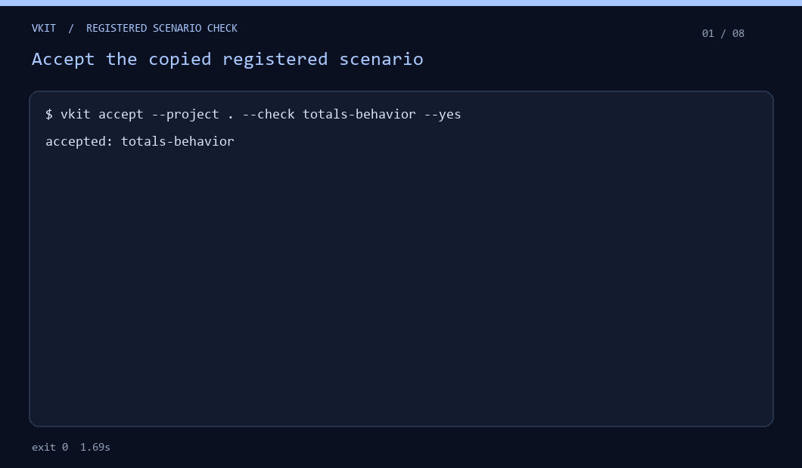

<p align="center">
  
</p>

<h1 align="center">VKit</h1>

<p align="center">Verification and evidence for AI-assisted software development.</p>

<p align="center">
  <a href="https://github.com/RoyCoding8/vkit/actions/workflows/ci.yml"></a>
  <a href="https://github.com/RoyCoding8/vkit/blob/main/pyproject.toml"></a>
  <a href="LICENSE"></a>
</p>

<p align="center">
  <a href="#get-started">Get started</a> ·
  <a href="docs/console.md">Console guide</a> ·
  <a href="docs/tool-discovery.md">MCP tools</a> ·
  <a href="docs/verification.md">Verification reference</a>
</p>

VKit runs tests and formal verification for coding agents and developers. It keeps each result tied to the code, requirements, and tools it covers, with a CLI, an MCP server, and a local web console.

A totals function passes its tests. An edit makes `10 + 20 + 12` return `45`, but the previous run is still green. VKit detects that the passing evidence is stale and blocks the gate. Rerunning the check exposes the incorrect totals.



*A changed totals function invalidates its earlier passing result. The next run identifies incorrect totals and the gate rejects the change.*

## What you can do

- Run existing tests and analysis through registered checks, including scenario tests, pytest, Node tests, and property tests.
- Require current passing evidence before a change passes the verification gate. Changes to declared source inputs, requirements, or tools invalidate earlier results.
- Check stateful designs with TLA+ and TLC, and inspect counterexample traces within the model's configured bounds.
- Compare two finite state models and get a shortest sequence of actions that distinguishes their behavior.
- Check Lean theorems, verify the supported Verus resource-ledger contracts, and run bounded Kani checks of captured Rust models.
- Run checks and review logs, evidence freshness, feature coverage, and proposals across remembered repositories in the local web console.
- Check merge candidates against the target branch's accepted requirements in [protected CI](examples/protected-ci/README.md).

## Get started

Requires [uv](https://docs.astral.sh/uv/getting-started/installation/), Git, and Python 3.11 or newer.

```sh
git clone https://github.com/RoyCoding8/vkit.git
cd vkit
uv run python examples/quickstart.py
```

The example checks a Python CLI against six scenarios and reports `totals-behavior: PASS` with a `READY` gate. It creates an isolated repository under `tmp/` and accepts the bundled check definition automatically. `uv` installs the required Python dependencies.

See [Getting started](docs/getting-started.md) for repository setup and the verification workflow.

## Use the console

```sh
uv run vkit console --project /path/to/your-repository
```

The console provides check execution, run history, logs, coverage, and proposals. Its workspace picker switches between repositories, while **All workspaces** combines their status and pending proposals. See the [console guide](docs/console.md) for configuration and usage.

## Connect an agent

Install the MCP extra:

```sh
uv sync --extra mcp
```

Use this as your MCP client's stdio-server launch command:

```sh
uv run vkit mcp serve --project /path/to/your-repository
```

The [MCP guide](docs/tool-discovery.md) covers client configuration, tool discovery, and availability settings. An optional [Claude Code plugin](plugin/) adds workflow guidance and hooks.

## Verification methods

| Method | Use it for |
| --- | --- |
| Registered checks | Scenario tests, pytest, Node tests, property tests, and static analysis. |
| TLA+ and TLC | Exhaustive exploration of a model within its configured finite bounds. |
| Lean | Kernel-checked theorems with statement binding and an axiom audit. |
| Verus | Source proofs for the owned resource-ledger package and its declared API bindings. |
| Change certification | Bounded Kani checks of captured Rust models and sampled observations of Rust, Python, or TypeScript changes. |
| Transition comparison | Exact comparison of explicit finite models, with shortest paths to differences. |
| External verifiers | A pinned producer and checker with a declared evidence contract. |

Each result states its scope and assurance. A test pass covers the recorded observations; a finite model result covers the declared model and bounds. Source verification applies to the supported contracts and bindings. See [verification semantics](docs/verification.md) for the assumptions, tool requirements, and limits of each method.

### Compare behavior before and after a change

The included toggle example compares two finite models. The candidate opens after the first click but incorrectly stays open after the second:

```sh
uv run vkit model compare --request examples/model-comparison/request.json
```

VKit reports the shortest, two-step path to the difference. The command exits with code `1` because the models differ. See [finite transition comparison](docs/verification.md#compare-finite-transition-models) for the model format and result details.

## Documentation

| Guide | Contents |
| --- | --- |
| [Getting started](docs/getting-started.md) | Repository setup, check execution, and evidence freshness. |
| [Console guide](docs/console.md) | Run checks, understand incomplete evidence, and manage workspaces. |
| [MCP tools and settings](docs/tool-discovery.md) | Connect an agent, discover tools, and control availability. |
| [Verification reference](docs/verification.md) | Formal components, model comparison, change certification, and evidence semantics. |
| [External verifier protocol](docs/backend-protocol.md) | Integrate an evidence producer and checker. |
| [Protected CI](examples/protected-ci/README.md) | Check a combined candidate against the target branch's policy. |

Explore the [Python CLI](examples/python-cli/README.md), [Node CLI](examples/node-cli/README.md), [HTTP service](examples/node-http/README.md), [Lean proof](examples/lean-proof/README.md), and [resource ledger](examples/ledger-reuse/README.md) examples.

## Contributing

See [Contributing](CONTRIBUTING.md) for development setup, tests, and asset builds. Report bugs and request features in [GitHub Issues](https://github.com/RoyCoding8/vkit/issues).

## License

VKit is licensed under [Apache 2.0](LICENSE). Bundled frontend dependencies retain their [upstream licenses](tools/console/README.md#sources-and-licenses).
