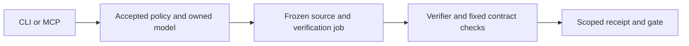

# VKit

Formal verification infrastructure for AI coding agents, through CLI and MCP.

VKit provides reusable mathematical models and checks whether declared software components satisfy their contracts. An agent selects a component and source revision. VKit determines the required obligations, runs the verification procedure, and retains evidence tied to the exact source, policy and tools.



## Supported verification

| Method | What it establishes |
| --- | --- |
| Owned resource-ledger package | Verus source proofs across six declared API bindings; reusable atomic transfer and lock-protected operation contracts. |
| Lean | Kernel-checked theorems, with statement binding and an axiom audit according to the selected profile. |
| TLA+ and TLC | Exhaustive checking of a finite model at its declared configuration. |
| External verifier protocol | Evidence checked by a separately pinned checker under its declared assurance contract. |
| Registered tests and analysis | Empirical results from scenario, pytest, property, Node test and SARIF adapters. |

The first owned package uses `ledger.source.v1` with `trusted_engine` assurance. It covers the bound APIs under the Verus/Rust/vstd/SMT trust boundary. It does not establish whole-application correctness, independently checked kernel certificates, compiled-binary correspondence or operational resource bounds.

## Set up

Requires Python 3.11+, Git and [uv](https://docs.astral.sh/uv/).

```sh
git clone https://github.com/RoyCoding8/vkit.git
cd vkit
uv sync --extra mcp
uv run vkit doctor --project /path/to/repository
```

The target repository declares its checks and formal components in `verification/manifest.json`, [schema version 3](schemas/manifest.v3.json). Verifier tools are provisioned separately. The initial Verus profile requires Linux x86_64, Docker and the pinned tool assets described in [verification semantics](docs/verification.md).

## Verify a component

For a configured component named `allocation`:

```sh
uv run vkit accept --project /path/to/repository --component allocation
uv run vkit verify allocation --project /path/to/repository --candidate HEAD --wait 0 --json
uv run vkit run wait --project /path/to/repository --run RUN_ID --json
```

Use `--working-tree` instead of `--candidate REF` for provisional source. Submissions create fresh attempts by default; `--reuse` returns intact passing evidence only when the complete captured source, policy and checker match. Workers survive client exit. Retry preserves the frozen job; replay checks evidence and runs verification again.

Registered checks use `vkit check run --check CHECK_ID`. `vkit status` reports freshness and missing evidence. `vkit gate` requires current passing evidence for registered checks and required formal components.

For CI, the [protected gate](examples/protected-ci/README.md) freshly checks an exact combined candidate against target policy. Candidate policy deletion and previously passing branch receipts cannot remove those requirements. Merge enforcement requires protected host configuration.

## Connect an agent

```sh
uv run vkit mcp serve --project /path/to/repository
```

The default compact interface exposes `help` and `invoke`. Use `help(all=true)` for discovery and `help(name="verify")` for the formal request schema. Add `--exposure named` to advertise enabled tools individually. CLI and MCP share the same jobs, receipts and availability settings.

The optional [Claude Code plugin](plugin/) adds workflow guidance and hooks. Acceptance is a CLI action; an agent with shell access can invoke it. MCP visibility and advisory hooks are not host security boundaries.

A local console is available with `uv run vkit console --project /path/to/repository`. It uses packaged assets and requires no browser access to external services.

## Documentation

- [Verification semantics and formal component configuration](docs/verification.md)
- [External verifier protocol](docs/backend-protocol.md)
- [Tool discovery and settings](docs/tool-discovery.md)
- [One model through two API interpretations](examples/ledger-reuse/README.md)
- [Protected CI integration](examples/protected-ci/README.md)
- Registered-check examples: [Python CLI](examples/python-cli/README.md), [Node CLI](examples/node-cli/README.md), [HTTP service](examples/node-http/README.md), [Lean](examples/lean-proof/README.md)

## Development

```sh
uv sync --extra test
uv run pytest
uv build
```

[Core CI](.github/workflows/ci.yml) runs the retained suite on Windows, Linux and macOS, checks wheel installation, and exercises real Lean/TLC controls and the bounded job-lifecycle model. [Ledger qualification](.github/workflows/ledger-qualification.yml) checks the installed Verus procedure, deliberate defects, verified representation conversions, durable execution, protected candidate gates, reuse and orchestration cost. See [console assets](tools/console/README.md) for frontend builds.
