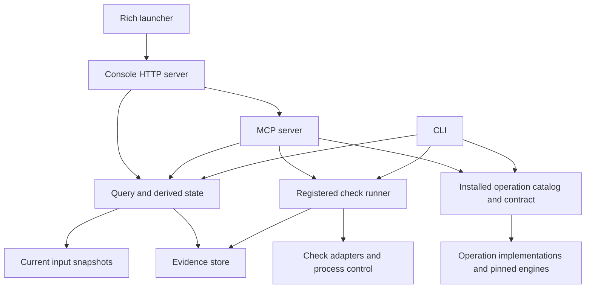

# Repository architecture

Vkit has two execution paths. Registered checks publish evidence about approved repository inputs.
Installed computations answer a fixed question and return their own scoped result. Most do not
publish check evidence. `check_release_artifact` runs an accepted build check and records its evidence.

The CLI, MCP server, and console share these paths. Agent discovery comes from MCP `help`, including
saved tool visibility. [Adding operations](adding-operations.md) describes the common `Operation` contract.

## Ownership map

Paths below are relative to the repository root.

| Area | Owning files | Responsibility |
| --- | --- | --- |
| Repository identity | `src/vkit/paths.py` | Resolve the checkout and shared Git directory. |
| Input identity | `src/vkit/inputs.py` | Select files, exclude secret names, and compute normalized content digests. |
| Check definitions | `src/vkit/manifest.py`, `schemas/`, `src/vkit/schemas.py` | Parse and validate approved check definitions and scenario artifacts. |
| Check types | `src/vkit/verifiers/spec.py`, `src/vkit/verifiers/obligation.py` | Represent supported checks and their required obligations. |
| Check execution | `src/vkit/runner.py`, `src/vkit/proc.py`, `src/vkit/verifiers/dispatch.py` | Enforce approval, launch a registered check, interpret its artifact, and publish its result. |
| Check-specific semantics | `src/vkit/verifiers/` | Translate a particular report or toolchain in an adapter or runner into observations, counterexamples, or a blocked result. |
| Evidence storage | `src/vkit/store.py` | Own run paths, atomic JSON writes, liveness locks, cancellation, approvals, and baselines. |
| Evidence interpretation | `src/vkit/state.py`, `src/vkit/outcome.py`, `src/vkit/claimkind.py`, `src/vkit/budgets.py` | Derive freshness and the gate, represent outcomes, attach claim limits, and evaluate declared budgets. |
| Read models | `src/vkit/query.py` | Return shared status, run summaries, bounded log windows, and prerequisite findings. |
| Discovery and proposals | `src/vkit/discover.py`, `src/vkit/features.py`, `src/vkit/proposals.py` | Inspect declared project configuration, map behaviors to checks, and stage changes for operator acceptance. |
| Computation integration | `src/vkit/operations/catalog.py`, `src/vkit/operations/contract.py` | Declare one versioned schema, defaults, handler, execution metadata, and outcomes for every computation. |
| Computation semantics | `src/vkit/operations/` | Own each question's model, input limits, execution, and witness checks. `_runtime.py` owns the shared binary path and SHA-256 identity check. |
| Operator settings | `src/vkit/settings.py` | Persist launch defaults in the user config directory and display preferences and disabled tool names in shared Git state. |
| Terminal launcher | `src/vkit/tui.py`, `tui.py`, `start.bat`, `start.sh` | Select the target repository and own the web console server's lifecycle. |
| Interfaces | `src/vkit/cli.py`, `src/vkit/mcp/__init__.py`, `src/vkit/console.py` | Translate requests and errors, apply saved visibility, and call the owning implementation. |
| Console rendering | `src/vkit/console.js`, `src/vkit/console.html`, `src/vkit/console.css` | Render query results, schema-driven computation forms, and operator settings. |
| Console assets | `tools/console/`, `src/vkit/console-assets/` | Build and ship the offline Material components, fonts, theme, and icons. |
| External helpers | `tools/` | Hold pinned helper source, package locks, and fixed backend configuration. |
| Acceptance and verification | `tests/`, `scripts/e2e.py`, `.github/workflows/ci.yml` | Exercise public interfaces, check adapters and engines, and verify integrated behavior across supported platforms. |
| Agent guidance | `plugin/` | Provide optional discovery and verification guidance. Guidance is separate from verifier correctness. |

## Registered check flow

`manifest.py` builds a typed check from the installed schema. Operator acceptance records its digest
in `Store`. `runner.run_check` captures declared inputs and derives an evidence key from the check
definition, inputs, baseline, and vkit version. It refuses execution without the current approval.

`dispatch.py` chooses the adapter. `proc.py` controls the child process tree, timeout, and cancellation.
The adapter interprets the report against required obligations. The runner checks input freshness again
before publishing through `Store`. An exit code alone cannot establish a pass.

`state.py` derives freshness and the gate from current inputs and stored evidence. `query.py` builds
the response used by the interfaces. Category and scope come from the registered check type, so a
renderer cannot upgrade a sampled result into a proof. [Verification reference](verification.md)
defines the result semantics.

## Computation flow

`catalog.py` contains installed `Operation` declarations. `contract.py` validates arguments, applies
defaults, calls the handler, and rejects undeclared statuses or non-JSON results. The CLI generates
flags from the same declaration that MCP publishes as its input schema. The console generates forms
from those schemas and calls the shared MCP dispatcher.

An operation owns the meaning of its evidence. The common contract checks transport shape and declared
statuses. It does not establish solver correctness or validate every operation-specific witness.
Optional engine imports stay out of tool listing and help.

The common binary identity check accepts a configured file only when its SHA-256 matches the configured
pin. Version checks and backend-specific protocols remain in their operations. Java and Node helper
toolchains retain their own multi-file identity rules. Combining them into a generic process framework
would hide different trust assumptions behind one interface.

## State and installation boundaries

`<git common directory>/vkit/` holds run records, logs, evidence pointers, approvals, baselines,
proposals, and `config.json`. Worktrees share this state while retaining separate source files.
User launch defaults live outside the repository in the platform config directory, unless
`VKIT_CONFIG` selects another JSON file. The console displays both settings paths.
Run IDs are identifiers containing letters, digits, underscores, or hyphens. The store rejects path
fragments before any run access. Log queries seek to the requested byte window instead of loading
the complete file.

The wheel includes schemas and offline console assets. Editable installs read schemas from the
checkout. Engine executables and helper runtimes require separate operator configuration.
An agent with permission to overwrite the service installation or its settings can change its behavior.
[Protect the service](computations.md#protect-the-service) describes the deployment boundary.

## Maintenance boundaries

Extend an existing operation when another backend answers the same question under another fixed model.
Add a new declaration when the question differs. Interface-specific tool lists, default values, or
dispatch branches duplicate the catalog's ownership.

Share code when callers enforce the same invariant. Keep source-language validation, model semantics,
snapshot rules, and solver protocols local when their assumptions differ. A short wrapper is justified
when it adapts a result or preserves optional imports. A forwarding layer with no such role adds another
place to trace.

`console.js` remains the largest handwritten module. It contains rendering, request handling, and UI
state in one file. A future interaction change should extract the state it owns with its render and
event handlers together. Splitting it by arbitrary line counts would leave the same shared mutable
state spread across files.

`tests/helpers.py` starts actual CLI and MCP processes using the selected interpreter.
The source-hygiene gate rejects direct `sys.path` redirection in test code, which would bypass an installed
wheel. Engine tests can skip unavailable runtimes; a skip does not verify that backend. CI configures
the supported backends and runs the wider suite.

Keep implementation history and session artifacts under ignored `tmp/`. Keep current behavior and
ownership here. The [ranked backlog](tool-backlog.md) holds research candidates, and the
[engine roadmap](engine-roadmap.md) records integration status.
