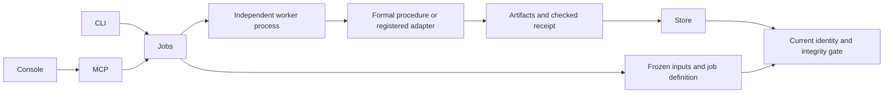

# Architecture

## System map

CLI, MCP, and the console use one job service. A version-3 manifest declares registered checks and formal components. A formal component binds candidate API names to VKit's owned mathematical package. An agent selects the component and source; it cannot supply replacement contracts or checker commands in a verification request.

| Component | Role |
| --- | --- |
| Owned package | Resource-ledger mathematics, six expected operation contracts and pinned verifier release. |
| Component policy | Reviewed package identity, source entrypoint, capacity and API-name bindings. |
| Job | Frozen source and accepted policy/checker identities. |
| Worker | Checks actual tools, executes verification and publishes evidence. |
| Receipt | Records scope, obligations, actual tool inventory and artifact hashes. |
| Gate | Requires intact passing evidence for the intended source and authority. |

## Module ownership

| Owner | Responsibility |
| --- | --- |
| `manifest.py`, `formal/policy.py`, `verifiers/spec.py`, `schemas/manifest.v3.json` | Parse tagged component policies, check variants and backend declarations. |
| `formal/ledger.py`, `formal/packages/resource_ledger/` | Resolve the owned model, fixed expected contracts and obligations. |
| `formal/verus.py`, `container.py` | Inventory actual verifier assets and run model/candidate/expected verification in one restricted container. |
| `job.py`, `ci.py` | Define immutable job subjects and enforce protected target policy for exact Git candidates. |
| `inputs.py`, `evidence.py` | Capture input closure, hash policy and tool identities, seal and validate bundles. |
| `jobs.py` | Submit, wait, capture replay evidence, and launch independent workers. |
| `runner.py` | Claim an attempt, enforce approval, execute on frozen inputs, and publish a receipt. |
| `verifiers/dispatch.py` | Choose native commands and report adapters. |
| `verifiers/external.py` | Run the producer, generate the checker request, and validate the receipt. |
| `proc.py` | Control descendants, deadlines, cancellation, and output capture. |
| `store.py` | Atomic records, OS liveness locks, cancellation markers, approvals, and evidence pointers. |
| `state.py`, `query.py` | Derive freshness, gates, and shared read models. |
| `cli.py`, `mcp/`, `console.py` | Validate transport requests and call the service. |

## Job identity

| Identity component | What it binds |
| --- | --- |
| Definition | Accepted manifest entry. |
| Inputs | Registered checks bind normalized declared inputs. Formal components bind raw captured bytes and source mode, including Git commit/tree/blob identities. |
| Backend | Accepted checker digest. Formal execution hashes actual tools and retains the matching inventory in the receipt. |
| Policy | VKit validation code and package version. |
| Baseline | Accepted baseline for checks that use one. |

- Each submission creates a distinct attempt.
- The persisted job includes its accepted definition. A later manifest edit cannot rewrite that attempt.
- The current gate uses the current definition and inputs.

## Execution lifecycle

| Stage | Worker behavior | Invariant |
| --- | --- | --- |
| Capture | Copy selected files into `snapshot/` and verify hashes. | Execution reads captured inputs. |
| Queue | Persist the job, record, and worker PID. | Client restart does not erase the submission. |
| Claim | Take the attempt's OS lock and load its persisted definition. | A second worker cannot execute that attempt. |
| Execute | Run the native adapter or external producer/checker from the frozen working directory. | External production and acceptance remain separate. |
| Publish | Recheck input and backend identity, then retain artifacts and the receipt. | Changed identity cannot produce fresh passing evidence. |
| Recover | Report a dead worker as interrupted. Explicit retry creates another attempt. | Worker loss never becomes a pass. |

There is no scheduler daemon or generic prover checkpoint engine.

## Evidence and gate validation

| Link | Binding |
| --- | --- |
| Evidence pointer | Hashes the final record. |
| Record | Hashes `receipt.json`. |
| Receipt | Hashes retained artifacts and binds the input closure and backend identity. |
| Gate | Validates the links, files, and current identity before accepting passing evidence. |

| Change | Consequence |
| --- | --- |
| Checker changes | Requires renewed acceptance. |
| Source or baseline changes | Produces a different job key. |
| Receipt or artifact tampering | Invalidates retained evidence. |

## Export and replay

1. Export copies a complete, validated attempt.
2. Replay requires matching current definition, input closure, and checker identity.
3. Replay captures and validates the source bundle before acknowledging submission.
4. The new worker performs checking and produces a new receipt.

| Backend | Replay operation |
| --- | --- |
| External | Copy declared proof artifacts into a new attempt and invoke the accepted checker. |
| Lean | Recompile frozen proof sources. |
| TLC | Rerun the model checker on the frozen model. |
| Verus component | Recapture the candidate and rerun the model, candidate and unchanged expected client. |

Imported outcome fields never substitute for checking.

## Trust boundaries

| Component | Trust requirement or limit |
| --- | --- |
| Local store and installed policy | Trusted. Hashes do not authenticate their writers. |
| Producer and checker | Run with the service user's filesystem permissions. Protect checker code and state from untrusted producers. |
| External dependencies | Pin code entrypoints and declared transitive trusted dependencies. |
| Dependency discovery | VKit checks file arguments and explicit pins. It cannot infer arbitrary binary dependencies. |
| Native identity | Records resolved executables, adapter policy, and relevant environment settings. |
| Native runtime libraries | Remain trusted environment dependencies. |
| External closure | Explicit dependency pins support a fully declared tool closure. |
| Registered local execution | Native and external commands retain service-user permissions. |
| Formal and protected-CI execution | Restricted Docker container, read-only source/tools, no network and private output. Host policy, installation and Docker remain trusted. |

## Storage and packaging

| Location or artifact | Contents or ownership |
| --- | --- |
| `<git common directory>/vkit/` | Attempts, snapshots, logs, artifacts, receipts, pointers, approvals, baselines, proposals, and settings. |
| Git worktrees | Share the store while retaining distinct input content. |
| JSON writes | Atomic replacement prevents partial records. |
| Per-attempt OS locks | Control execution ownership. |
| Python wheel | Includes schemas, one owned mathematical package/templates/pins and offline console assets. |
| External verifiers | Installation remains under operator control. |

Adding an external verifier changes its manifest and backend implementation. It requires no transport registry changes.

The first owned package covers ledger accounting and six declared APIs. It does not infer how real workers, quotas or caller identities correspond to the model. See the [reuse examples](../examples/ledger-reuse/README.md) and [protected gate](../examples/protected-ci/README.md) for those boundaries.
