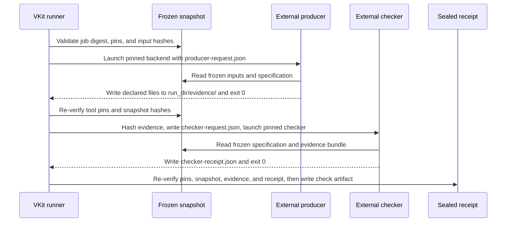

# External verifier protocol

This reference specifies the protocol for integrating an external evidence producer and an independent checker with VKit. The accepted manifest entry (`kind: "external"` in `schemas/manifest.v3.json`) pins both commands and defines the claim their evidence must establish. Implementation lives in `src/vkit/verifiers/external.py` and `src/vkit/verifiers/spec.py`. For built-in check kinds, see the [verification reference](verification.md).

## Protocol flow



## Roles and manifest declarations

Each external check separates evidence production from evidence checking.

| Role | Responsibility |
| --- | --- |
| Producer (`backend`) | Generate the declared evidence files under `run_dir/evidence/`. |
| Checker (`checker`) | Independently verify the evidence files against the accepted claim and write `checker-receipt.json`. |
| VKit runner | Freeze inputs, verify content pins, generate JSON requests, validate the receipt, and write the sealed check artifact. |

An accepted `external` entry in `verification/manifest.json` (`schemas/manifest.v3.json`) fixes the following declarations.

| Field | Required | Meaning |
| --- | --- | --- |
| `id` | Yes | Stable check identifier. |
| `kind` | Yes | Must be `"external"`. |
| `specification` | Yes | Normalized repository-relative POSIX path to the frozen specification file. |
| `obligations` | Yes | Nonempty ordered list of unique obligation names. |
| `assumptions` | Yes | Unique list of declared assumption strings. |
| `model_scope` | Yes | Nonempty string describing the model scope. |
| `assurance` | Yes | Assurance label: `"kernel_proof"` or `"trusted_engine"`. |
| `evidence_artifacts` | Yes | Nonempty list of unique normalized paths relative to `run_dir/evidence/`. |
| `backend` | Yes | Pinned producer command (`executable`, optional `argv`, optional `dependencies`). |
| `checker` | Yes | Pinned checker command (`executable`, optional `argv`, optional `dependencies`). |
| `trusted_tool_dependencies` | No | Optional list of additional pinned files, such as proof kernels or model checkers. |
| `timeout_seconds` | Yes | Positive finite time budget in seconds (maximum `86400`). |
| `artifact` | Yes | Filename for the sealed check metadata written inside `run_dir`. |
| `subject` | Yes | Subject paths and expected or measured digest. |
| `claim_id` | Yes | Stable claim identifier. |

The producer cannot choose the checker or change the obligations expected during replay.

## Command identity and pinning

Every file pin in `backend`, `checker`, and `trusted_tool_dependencies` requires a `path` and a 64-character lowercase hexadecimal `sha256` digest.

| Field or rule | Requirement |
| --- | --- |
| `executable` | Regular file resolved with `Path.resolve(strict=True)` whose SHA-256 matches `sha256`. |
| `dependencies` | Pinned scripts and code files read by the command. Any absolute file path in `argv` must appear in `executable` or `dependencies`. |
| `trusted_tool_dependencies` | Additional trusted files sorted by `path` in `identity(check)`. |
| `argv` | Argument array passed directly without a shell. |
| Pin verification | VKit computes `identity(check)` before job validation, before each command launch, and after each command exits. |
| Version strings | Version strings do not substitute for SHA-256 content pins. |
| Dependency closure | The manifest author must declare all required files. VKit does not infer transitive binary dependencies. |

`identity(check)` in `src/vkit/verifiers/external.py` returns the canonical tool identity object with keys `protocol` (`1`), `implementation`, `backend`, `checker`, `trusted_tool_dependencies`, and `host` (`platform`, `system_root`, `windir`, `execution_environment: "vkit-external-v1"`).

## Paths, snapshot, and execution environment

All relative paths must be normalized POSIX paths without backslashes, `..`, or symlinks.

| Path | Meaning and requirement |
| --- | --- |
| `specification` | Normalized repository-relative POSIX path. Must appear in the job's frozen `inputs.files` closure. |
| `evidence_artifacts` | Normalized relative paths under `run_dir/evidence/`. Each must be a regular file, not a symlink. |
| `run_dir/snapshot` | Frozen copy of declared inputs. Every input file hash is verified before and after each command. |
| `cwd` | Working directory inside `run_dir/snapshot` (defaults to `.`). Must be a real directory inside the snapshot. |
| `run_dir/evidence/` | Output directory for declared evidence files. |
| `run_dir/producer-request.json` | JSON request generated for the producer. |
| `run_dir/checker-request.json` | JSON request generated for the checker, including `evidence_bundle`. |
| `run_dir/checker-receipt.json` | Receipt output path passed to the checker as `{{receipt}}`. |
| `run_dir/<artifact>` | Sealed metadata JSON written by VKit after receipt validation. |

VKit runs both commands with a restricted environment (`PATH=""`, `PYTHONNOUSERSITE="1"`, `LANG="C"`, `LC_ALL="C"`). On POSIX systems, VKit sets `TMPDIR` to `run_dir/tmp`. On Windows, VKit preserves `SYSTEMROOT` and `WINDIR` and sets `TEMP` and `TMP` to `run_dir/tmp`.

Writing evidence under `run_dir/evidence/` is a protocol requirement, not an OS filesystem sandbox.

## Argument placeholders

VKit expands placeholders inside individual elements of `argv` without shell interpolation. Unknown `{{...}}` placeholders fail validation.

| Placeholder | Expanded value |
| --- | --- |
| `{{python}}` | Resolved path of the command's pinned `executable`. |
| `{{snapshot}}` | Path to `run_dir/snapshot`. |
| `{{run_dir}}` | Path to the current attempt directory. |
| `{{request}}` | Path to `producer-request.json` or `checker-request.json`. |
| `{{evidence}}` | Path to `run_dir/evidence`. |
| `{{receipt}}` | Path to `run_dir/checker-receipt.json` for the checker (`run_dir/producer-receipt.json` for the producer, whose contents are ignored). |

## Execution sequence

`execute()` in `src/vkit/verifiers/external.py` runs these steps in order:

1. Compute `identity(check)`, validate the version 1 job object, and verify every file hash in `run_dir/snapshot`.
2. Create `run_dir/evidence/` and write `run_dir/producer-request.json`.
3. Re-verify `identity(check)` and launch `backend` with the configured `timeout_seconds`.
4. Confirm `backend` exited with status `0`, re-verify `identity(check)` and `run_dir/snapshot`, and hash every declared file in `run_dir/evidence/`.
5. Check remaining time budget, remove any stale `run_dir/checker-receipt.json`, and write `run_dir/checker-request.json` with `evidence_bundle`.
6. Re-verify `identity(check)` and `run_dir/snapshot`, then launch `checker` with the remaining time budget.
7. Confirm `checker` exited with status `0`, re-verify `identity(check)` and `run_dir/snapshot`, and confirm `run_dir/evidence/` files did not change.
8. Validate `run_dir/checker-receipt.json`, compute its SHA-256 digest, and write the sealed check artifact to `run_dir/<artifact>`.

## Checker receipt schema

The checker must write a UTF-8 JSON object to `{{receipt}}` with these exact ten keys:

```json
{
	"schema_version": 1,
	"job_id": "<64 lowercase hex characters>",
	"run_id": "<current run id>",
	"check_id": "<approved check id>",
	"check_digest": "<approved manifest-entry digest>",
	"specification_digest": "<frozen specification sha256>",
	"identity": "<complete identity(check) JSON object>",
	"evidence_digest": "<canonical digest of sorted evidence path and sha256 pairs>",
	"verdict": "accepted",
	"obligations": [
		{"name": "<approved obligation>", "result": "accepted", "evidence": ["proof.bin"]}
	]
}
```

The example abbreviates `identity`. A real receipt must embed the complete JSON object returned by `identity(check)`.

| Receipt field | Validation rule |
| --- | --- |
| Exact keys | No missing keys and no extra keys outside the ten listed fields. |
| `schema_version` | Must be `1`. |
| `job_id`, `run_id`, `check_id`, `check_digest` | Must equal the current job values. |
| `specification_digest` | Must equal the frozen specification SHA-256 in the job input closure. |
| `identity` | Must equal the complete current `identity(check)` object. |
| `evidence_digest` | Must equal `canonical_digest(files)` for the sorted evidence path and SHA-256 list. |
| `obligations` | Every accepted obligation must appear once in manifest order with keys `name`, `result`, and `evidence`. |
| Obligation `result` | Must be `"accepted"`, `"rejected"`, or `"unknown"`. |
| Obligation `evidence` | Nonempty list of paths that exist in the captured evidence bundle. |
| `verdict` | Must equal `"accepted"` if all obligations are accepted, `"rejected"` if any is rejected, and `"unknown"` otherwise. |
| Exit status | Exit code `0` is required, but exit code `0` alone does not accept the check without a valid receipt. |

## Outcomes and verdicts

| Condition | VKit outcome | Blocked reason | Meaning |
| --- | --- | --- | --- |
| Valid receipt with `verdict: "accepted"` | `PASS` | None | Obligations established under the declared checker contract. |
| Valid receipt with `verdict: "rejected"` | `BLOCKED` | `ARTIFACT_MALFORMED` | Inconclusive. Does not establish a theorem counterexample. |
| Valid receipt with `verdict: "unknown"` | `BLOCKED` | `ARTIFACT_MALFORMED` | Inconclusive. |
| Non-zero exit, output limit, bad receipt, or protocol error | `BLOCKED` | `ARTIFACT_MALFORMED` | Output or contract check failed. |
| Command launch error | `BLOCKED` | `LAUNCH_FAILED` | Process could not start. |
| Deadline exceeded | `BLOCKED` | `TIMEOUT` | Command and descendants were stopped. |
| Cancellation requested | `BLOCKED` | `CANCELLED` | Command and descendants were stopped. |

A formal `FAIL` outcome requires an explicit counterexample protocol. The external protocol does not define one.

## Replay

`replay()` in `src/vkit/verifiers/external.py` re-checks retained evidence without running the producer.

| Step | Action |
| --- | --- |
| Validate | Compute `identity(check)`, validate the job object, and verify `run_dir/snapshot`. |
| Copy evidence | Copy every declared file from `source_run_dir/evidence/` into the fresh `run_dir/evidence/` and hash each copy. |
| Check | Run the currently pinned `checker` against the fresh `checker-request.json` with full `timeout_seconds`. |
| Ignore prior status | Do not trust stored status fields or prior receipts as checking results. |
| Seal | Validate the new receipt and write the new receipt digest and artifact digests into `run_dir/<artifact>`. |

## Process control and trust limits

| Mechanism | Guarantee or limit |
| --- | --- |
| `proc.run` | Enforces configured deadlines and cancellation, and stops descendant processes. |
| Process user | Producer and checker run as the VKit OS user. |
| Pin and snapshot checks | Detect ordinary tool or snapshot modifications between stages. |
| Filesystem access | No OS filesystem sandbox is claimed. A process can mutate and restore files while running. |
| Dependency closure | Transitive binary dependencies are not inferred. The manifest author must pin required tools. |

Change-certification APIs and execution profiles are documented in the [change-analysis reference](change-analysis.md).
