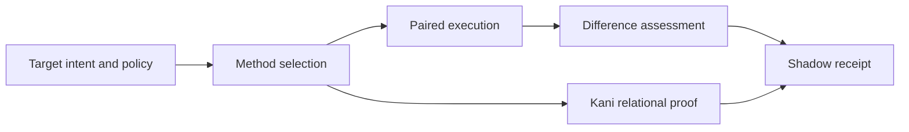

# Change analysis reference

This reference documents the Python APIs, execution profiles, status values, and authority boundaries for VKit change certification. For CLI verification semantics and protected gates, see [Verification semantics](verification.md).

## Pipeline overview

Change certification compares a candidate commit against a host-selected target commit under target-owned intent and difference policies.



1. **Target intent and policy.** Preflight binds the request to an exact target commit, loads accepted intent from target history, and locks all declared semantic artifacts.
2. **Method selection.** The planner chooses `finite_paired`, `rust_kani`, or both based on the declared language binding, host platform, and host-supplied toolchain pin.
3. **Paired execution and Kani relational proof.** Native paired execution runs base and candidate binaries on selected `u32` inputs. Kani relational execution checks a restricted Rust model on native x86-64 Linux.
4. **Difference assessment.** The assessor evaluates retained observations against accepted standing intent and target-owned difference guards.
5. **Shadow receipt.** The service writes `change-certification.json` with explicit `source_proof: false` and `approval_authority: false` flags.

## Authority boundary

Change certification runs as a shadow analysis path. It never grants approval authority and never promotes a candidate to pass `vkit gate`. The formal separation between shadow receipts, registered checks, formal goals, and gate readiness is modeled in [ShadowAuthority.tla](../formal/models/certification/ShadowAuthority.tla).

| Aspect | What change certification proves | What change certification does not prove |
| --- | --- | --- |
| Gate authority | Produces an auditable shadow receipt bound to exact Git captures and target policy. | Does not grant approval authority, override `vkit gate`, or satisfy protected CI gate requirements. |
| Paired execution | Candidate outputs match the request claim and difference policy on the executed finite inputs. | Does not cover omitted inputs, prove determinism, verify transitive dependencies, or run inside an OS sandbox. |
| Kani relational proof | Admitted Rust source satisfies the four generated relational assertions under the pinned Kani 0.68.0 engine model. | Does not establish native compiler correspondence, arbitrary Rust semantics, or full dependency closure. |
| Request preflight | Request base, candidate ancestry, accepted intent digest, and semantic artifact digests match target history. | Does not execute application code, authenticate a human reviewer, or issue a verification receipt. |

## Repository layout

| Path | Role |
| --- | --- |
| `src/vkit/change/intent.py` | Target-pinned finite intent preflight (`preflight_change_request`, `BoundChangeRequest`). |
| `src/vkit/change/certification.py` | Finite contracts, intent revisions, difference policies, and `assess_differences`. |
| `src/vkit/change/methods.py` | Method catalog (`METHOD_CATALOG`) and `select_change_methods`. |
| `src/vkit/change/paired.py` | Native paired execution runner (`run_paired_execution`, `PairedExecution`). |
| `src/vkit/change/paired_profiles.py` | Language bindings, file pins, and closed environment validation. |
| `src/vkit/change/analysis.py` | Combined paired execution and difference assessment (`run_change_analysis`, `ChangeAnalysis`). |
| `src/vkit/change/service.py` | Multi-method shadow orchestrator (`run_change_methods`) and receipt writer. |
| `src/vkit/change/witness.py` | Immutable change-witness encoding, parsing, and Kani input import. |
| `src/vkit/change/claim_acceptance.py` | Delegated claim acceptance validation (`checked_acceptance`, `validate_claim_acceptance`). |
| `src/vkit/rust/rust_source.py` | Tree-sitter Rust source admission (`admit_rust_source`, `RustSourceProfile`). |
| `src/vkit/rust/rust_relational.py` | Relational obligation and claim program preparation (`prepare_rust_relational`, `prepare_rust_claim_program`). |
| `src/vkit/rust/kani_toolchain.py` | Closed Kani and Rust toolchain validation (`KaniToolchain`, `validate_kani_toolchain`). |
| `src/vkit/rust/kani_execution.py` | Captured Rust Kani execution (`run_kani_relational`, `run_kani_claim`). |
| `src/vkit/rust/kani_result.py` | Kani export decoding and classification (`classify_kani_result`, `KaniOutcome`). |
| `formal/models/certification/` | TLA+ models for authority, finite differences, decision bridging, and shadow isolation. |
| `formal/checks/` | Qualification scripts that check witnesses, authority invariants, decision bridges, and Kani classification. |

## Finite intent preflight

`vkit.change.intent.preflight_change_request(project, request_json, trusted_target_oid=...)` binds a finite request to an accepted intent in an exact Git target commit. The trusted caller supplies `trusted_target_oid` separately from the request. The request base commit must equal `trusted_target_oid`, and `trusted_target_oid` must be an ancestor of the candidate commit. An unchanged candidate commit is allowed. Branch names and working-tree sources are rejected.

The target commit tree stores two target-owned files:

- `verification/change-intents/accepted.v1.json` lists accepted revision digests under `accepted` with `schema_version` set to `1`. Its structure is defined in [accepted-intents.v1.json](../schemas/accepted-intents.v1.json).
- `verification/change-intents/<digest>.v1.json` stores the intent revision document. Its digest is `IntentRevision.from_json(document).digest`, defined in [intent-revision.v1.json](../schemas/intent-revision.v1.json).

Each intent revision requires a literal requirement source and statement, a finite contract, and four semantic artifacts. The four artifacts pin the path and raw-byte SHA-256 of the binding map, codec, observation policy, and environment model. The codec, observation policy, and environment hashes must match the finite domain. `requirement.source` is retained as a citation label. Preflight does not resolve external links or verify that external documents match the stored statement.

Preflight reads captured Git objects rather than the working tree, candidate policy, or local `approved.json`. Every declared semantic artifact must exist unchanged in both exact commits. Candidate commits cannot accept a new intent revision, though application source may change.

The request claim must cover every legal input and output of the accepted intent on the same semantic domain. Empty intent domains, changed domains, and claims that exclude legal behavior fail preflight. A weaker entailed claim can bind, but binding grants no delegated authority.

The returned `BoundChangeRequest` holds the typed request, accepted intent, source capture identities, and policy blob identities. Its JSON output reports `scope: "request_preflight"` and `candidate_behavior_checked: false`. Preflight is read-only. It is not exposed through the public `vkit verify` CLI or MCP `verify` tool, which accept only version 2 package claims.

## Method selection

`vkit.change.methods.select_change_methods` builds a `ChangeMethodPlan` from `METHOD_CATALOG`. The request cannot choose commands, environment variables, a target commit, or a toolchain.

| Method | Languages | Evidence kind | Cost tier | Host requirements |
| --- | --- | --- | --- | --- |
| `finite_paired` | Rust, Python, TypeScript | `empirical_sampled_finite_observations` | `1` | Declared compiler or runtime tool hashes matching the pinned environment artifact. |
| `rust_kani` | Rust | `trusted_engine_model` | `2` | Native `x86_64-unknown-linux-gnu` host and a host-supplied closed Kani 0.68.0 toolchain pin. |

When `--method auto` is selected, VKit selects `finite_paired` first and adds `rust_kani` only when the binding is Rust on native x86-64 Linux with a host-supplied Kani toolchain pin. Requesting `--method rust_kani` on an unsupported binding or platform produces a blocked shadow job without falling back to `finite_paired`. Delegated claim requests require `rust_kani` only and cannot run native sampled methods.

## Sampled paired execution

`vkit.change.paired.run_paired_execution` runs captured base and candidate commits against the same selected inputs. The candidate must retain both `verification/change-intents/accepted.v1.json` and the selected digest-named intent revision byte for byte. Adding an unaccepted proposal revision is allowed and grants no authority.

The current execution profile supports one declared function that maps a `u32` input to a `u32` output in Rust, Python, or TypeScript. Each process reads four little-endian input bytes before importing the candidate module or calling the target function, then writes one canonical decimal `u32` line. Base and candidate runs execute separately with verified tool hashes and a closed set of environment variables. TypeScript uses a directly executable native compiler.

The retained report conforms to [paired-execution-report.v1.json](../schemas/paired-execution-report.v1.json) and uses four terminal statuses:

| Status | Meaning |
| --- | --- |
| `samples_within_contract` | Every selected observation is stable, and the candidate satisfies the request claim on those inputs. |
| `observed_violation` | A stable candidate observation violates the request claim. |
| `unknown` | A timeout, cancellation, budget limit, unsupported declaration, or unstable observation prevents a complete result. |
| `infrastructure_failure` | A build, launch, protocol, pin, source, or retained-artifact check failed. |

The paired runner enforces fixed resource limits:

| Limit | Value |
| --- | --- |
| Selected inputs | At most 4,096 |
| Repetitions per input | At most 32 |
| Shrink trials | At most 256 |
| Process invocations (including builds) | At most 128 |
| Combined `stdout` and `stderr` per invocation | At most 64 KiB |
| Per-process timeout | Default 10 seconds, at most 300 seconds |
| Total paired-run wall-clock deadline | 300 seconds after Git preflight |

Retained artifact hashes are verified before report serialization, and input bytes are verified before each launch. Candidate code runs with the caller's host permissions and can access the host filesystem. The report records `source_proof: false`, `dependency_closure_checked: false`, and `os_sandbox: false`.

## Protected finite difference analysis

`vkit.change.analysis.run_change_analysis` captures the trusted target and candidate once, runs paired execution, and evaluates retained observations against accepted standing intent and the target difference policy. The target policy resides at `verification/change-intents/differences/<intent-digest>.v1.json` and conforms to [finite-differences.v1.json](../schemas/finite-differences.v1.json). If the target commit has no policy file, no difference guards are approved. A candidate cannot add, modify, or delete that policy for its own analysis.

Before consuming observations, the analyzer verifies retained file bytes and live execution identities. Only successful, validated process outputs count as returned values. Failed-process output remains retained evidence. A known violation stays visible even when another input fails or coverage is incomplete. Standing output requirements always apply. Overlapping guards intersect their allowed outputs. Outside approved guards, candidate output must equal base output or perform an allowed standing-intent repair.

The retained report conforms to [change-analysis.v1.json](../schemas/change-analysis.v1.json) and records `source_proof: false` and `approval_authority: false`:

| Status | Meaning |
| --- | --- |
| `observed_conformance` | All selected inputs produced valid observations that satisfy standing intent and approved difference rules. |
| `observed_violation` | At least one validated observation violated standing intent or an unguarded difference rule. |
| `unknown` | Missing observations, incomplete coverage, or an incomplete paired execution prevented a conformance decision. |

## Restricted Rust Kani relational verification

### Source admission and obligation preparation

Install the optional `rust` dependencies to call `vkit.rust.rust_relational.prepare_rust_relational`. Preparation takes a project, finite request, and separately supplied `trusted_target_oid`, then returns a `RustRelationalProgram` containing bound captures, protected policy, source admission identities, and generated Rust check bytes. Preparation runs no verifier and binds no Kani toolchain.

`vkit.rust.rust_source.admit_rust_source` enforces profile `rust-u32-pure-v1`:

- Admits one public, non-generic `u32` to `u32` function.
- Supports literal expressions, immutable typed local bindings, blocks, `if` expressions, and `return` statements.
- Rejects configuration attributes, macros, imports, function calls, modules, globals, `unsafe` blocks, loops, and other unqualified syntax.
- Keeps exact captured files as separate modules without copying or rewriting function bodies.

Parsing runs in a separate Python process using tree-sitter runtime `0.26.0` and Rust grammar `0.24.2` (ABI `15`). The admission record captures native module hashes, grammar ABI, package versions, and the admission-code hash.

| Admission or preparation limit | Value |
| --- | --- |
| Source file size | At most 64 KiB |
| Parsed AST nodes | At most 3,000 |
| Parsed AST depth | At most 64 |
| Parser process timeout | 10 seconds |
| Parser combined output | At most 64 KiB |
| Finite domain inputs and observations | At most 4,096 |
| Approved guard requirements | At most 4,096 |
| Generated Rust check bytes | At most 256 KiB |

### Captured Kani execution and outcomes

`vkit.rust.kani_execution.run_kani_relational` executes a prepared `RustRelationalProgram` with a host-selected `KaniToolchain` and a fresh output directory. The qualified profile is `kani-0.68.0-x86_64-unknown-linux-gnu-v1` on native x86-64 Linux with Kani `0.68.0` and its pinned Rust nightly toolchain (`nightly-2026-08-21-x86_64-unknown-linux-gnu`). Other platforms return `unknown` with reason `unsupported_platform`.

`vkit.rust.kani_toolchain.validate_kani_toolchain` pins every file and directory mode across the selected Kani tree, Rust tree, rustup binary and proxy layout, and any supplied host libraries. Validation streams file contents before and after a completed engine run. Host utilities, the operating system, the kernel, the Python runtime, and unpinned libraries remain inside the trust boundary. Before-and-after scans cannot detect concurrent filesystem modifications that are restored between scans.

The runner materializes both Git captures, verifies complete file inventories and raw bytes, rejects symbolic links and special files, and rechecks source admission. The Kani process enforces a configurable timeout (default 90 seconds, at most 300 seconds), a 1 MiB combined `stdout` and `stderr` cap, and a 2 MiB result import limit. There is no OS memory or filesystem quota.

`vkit.rust.kani_result.classify_kani_result` requires the qualified export metadata, all four generated assertions at their expected source locations, consistent property counters, and passing safety properties. Every report records `source_proof: false`, `native_compiler_correspondence: false`, `approval_authority: false`, and `os_sandbox: false`.

| Outcome | Meaning |
| --- | --- |
| `verified` | Qualified export metadata, all four generated assertions, and all reported safety properties passed. |
| `proof_rejected` | Kani reported a failing assertion or safety property. A rejection without an imported input is not a native counterexample. |
| `unknown` | The host platform is unsupported, or a timeout, cancellation, output cap, or incomplete proof prevented a verdict. |
| `infrastructure_failure` | Toolchain validation, capture staging, engine launch, export decoding, or retained-artifact checks failed. |

## Change witness artifacts

`src/vkit/change/witness.py` encodes and validates immutable witness artifacts conforming to [witness.v1.json](../schemas/witness.v1.json). `parse_witness` validates the artifact against a separately supplied `WitnessBinding` and the retained artifact bytes. Producer-supplied identity fields do not establish their own authority.

| Kind | Meaning |
| --- | --- |
| `proof_rejected` | A proof attempt failed with no native playback attached. |
| `engine_counterexample` | Retains the engine input and counterexample with explicit native playback status where supported. |
| `model_witness` | Retains the model, configuration, and trace. Replay is absent or limited to the same model engine. |
| `unknown` | The attempt was incomplete, unsupported, interrupted, timed out, or exhausted its bound. |
| `infrastructure_failure` | The engine, importer, compiler, playback runner, or protocol failed. |

Native playback records whether the imported input reproduced the observation under its pinned runtime. A `model_witness` cannot carry native playback. Every artifact reference records a normalized retained path, SHA-256 digest, and media type. Import rejects modified bytes, symbolic links, and non-regular files.

To run the safe Rust witness qualification check from a source checkout, run:

```bash
python formal/checks/check_change_witness.py --output tmp/change-witness
```

This script creates disposable Git target and candidate commits, runs preflight, imports a labeled Kani transcript fixture, compiles and runs the captured `u32` sources, retains the runtime identity, and re-verifies the serialized witness. It does not invoke Kani and grants no approval or gate verdict.

## Shadow change-certification jobs

Submit a shadow change-certification job from the CLI:

```bash
vkit change certify \
	--project PATH \
	--request REQUEST.json \
	--trusted-target COMMIT \
	--method auto \
	--wait 0
```

| Flag | Requirement | Behavior |
| --- | --- | --- |
| `--project PATH` | Required | Path to the VKit project repository. |
| `--request REQUEST.json` | Required | Strict change certification request JSON conforming to [change-certification.v1.json](../schemas/change-certification.v1.json). |
| `--trusted-target COMMIT` | Required | Exact host-selected target commit OID matching the request base and target history. |
| `--method` | Optional | Accepts `auto` (default), `finite_paired`, or `rust_kani`. |
| `--kani-toolchain PIN.json` | Optional | Host-owned closed Kani toolchain pin JSON file. |
| `--wait SECONDS` | Optional | Finite number from `0` through `60` (default `0`). Returns the durable job summary after the wait expires. |

Use `vkit run wait --run RUN_ID` and `vkit run show --run RUN_ID` to track job progress and inspect logs.

The MCP tool `change_certify` accepts the same `request`, a separate `trusted_target_oid`, an optional method, and an optional host toolchain pin. It shares the standard VKit job store, worker, and retry lifecycle. `run_get` and `run_wait` return a compact shadow summary with the accepted requirement citation, intent digest, per-method status and report references, and `source_proof: false` and `approval_authority: false`.

`vkit.change.service.run_change_methods` writes `change-certification.json` with one top-level conclusion status:

| Receipt status | Meaning |
| --- | --- |
| `model_verified` | All scheduled methods succeeded, and at least one `rust_kani` method returned `verified`. |
| `observed_conformance` | All scheduled methods succeeded using `finite_paired`, and all reported `observed_conformance`. |
| `observed_violation` | A `finite_paired` method observed a violation. Remaining methods stop with `stopped: "checked_refutation"`. |
| `proof_rejected` | A `rust_kani` method rejected the proof. Remaining methods stop with `stopped: "checked_refutation"`. |
| `unknown` | A method could not complete, was cancelled, or a retained artifact changed after execution. |
| `unsupported` | No methods executed. |

When a request includes a delegated claim and the relational check reaches `model_verified`, `run_change_methods` runs `candidate_claim_satisfaction` and `near_miss_control` through `prepare_rust_claim_program` and `run_kani_claim`, then writes `claim-acceptance.v1.json` (defined in [claim-acceptance.v1.json](../schemas/claim-acceptance.v1.json)) if both checks match their expected outcomes.

## Formal qualification models

Developer checks for change-certification authority and decision logic live under `formal/models/certification/` and `formal/checks/`. See [formal/models/certification/README.md](../formal/models/certification/README.md) for TLC execution prerequisites.

| Model or check | Scope |
| --- | --- |
| `formal/models/certification/Authority.tla` | Submission binding, receipt validation, and evidence reuse across policy or source drift. |
| `formal/models/certification/Differences.tla` | Bounded finite observation assessment, guard intersection, repairs, and visibility of violations. |
| `formal/models/certification/DifferenceDecisionBridge.tla` | Terminal decision comparison between TLC and `assess_differences`. |
| `formal/models/certification/ShadowAuthority.tla` | Isolation between shadow change-certification receipts and protected gate readiness. |
| `formal/checks/check_authority.py` | Runs the TLC authority and finite-difference suites through VKit's registered-check interface. |
| `formal/checks/check_difference_decisions.py` | Compares TLC terminal decisions against the Python difference assessor. |
| `formal/checks/check_change_witness.py` | Exercises witness binding, Kani transcript import, native playback, and re-verification. |
| `formal/checks/check_kani_classifier.py` | Validates Kani result classification rules against positive and negative fixtures. |
| `formal/checks/check_delegated_claim_authority.py` | Checks delegated claim acceptance invariants and negative controls. |
