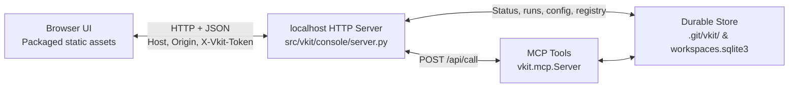

# Use the VKit console

The VKit console is a local web interface for running checks, inspecting run logs, reviewing proposals, and managing tool settings across remembered repositories.

## Start the console

Run this command from the VKit checkout:

```sh
uv run vkit console --project /path/to/your-repository
```

VKit binds an HTTP server on `127.0.0.1`, prints the local URL, and opens it in your browser. The interface ships as packaged static assets in `src/vkit/console/static`, so it requires no Node installation and no external web services.

Use these flags to override saved launch defaults:

| Flag | Purpose |
| --- | --- |
| `--project PATH` | Select the initial repository. Defaults to the saved project, then the current directory. |
| `--port PORT` | Bind a specific port from `0` to `65535`. Pass `0` to pick an open port. |
| `--browser` or `--no-browser` | Open or suppress the browser tab on startup. |

## Architecture

The console runs strictly on loopback (`127.0.0.1`). The server enforces `Host` and `Origin` checks along with a per-process CSRF token (`X-Vkit-Token`) on every `POST` request.



Read endpoints (`/api/status`, `/api/runs`, `/api/run`, `/api/config`, `/api/workspaces`) query the repository store and workspace registry directly. Action requests go through `/api/call` to the same MCP tool handlers that coding agents use.

## Run checks

Select a single workspace in the sidebar, then open **Checks**.

- Select **Run** beside a check to submit one attempt.
- Select **Run needed checks** to submit every check with stale or missing evidence.
- Open **Runs** to inspect live progress, stdout and stderr logs, artifacts, or to cancel a running attempt.

Select **Refresh** to reload repository status. Refreshing does not execute checks.

The console executes checks declared in `verification/manifest.json` that you have already accepted through the CLI. See [Getting started](getting-started.md) to configure a repository. For formal package verification, run `vkit verify` or call the MCP `verify` tool as described in the [verification reference](verification.md).

## Resolve incomplete evidence

Check states tell you why a check is not ready for the gate and what to do next:

| State | Next action |
| --- | --- |
| Not set up | Add a valid `verification/manifest.json`. Start with [Getting started](getting-started.md) or an [example](../README.md#documentation). |
| Not approved | Review and accept the check definition with `vkit accept --project /path/to/your-repository`. |
| Missing | Run the check. No evidence exists for it yet. |
| Stale | Run the check again. Its declared inputs or definition changed after the last run. |
| Failed | Open the run, read its observations and logs, fix the defect, and rerun. |
| Blocked | Open the run and resolve the reported prerequisite or execution error. |
| Fresh pass | No action required. The recorded pass matches the current inputs. |

The gate requires fresh passing evidence for every required check and formal component. Refreshing the view or keeping an older passing run does not satisfy the gate.

## Inspect capabilities and feature coverage

Open **Capabilities** to view the adapters used by registered checks in the selected workspace and how many checks use each adapter. **No checks registered** means the manifest defines no checks for that adapter. Install any required external tool, add a check definition to `verification/manifest.json`, and run `vkit accept` before expecting evidence from that adapter.

Formal package verification, change certification, and finite model comparison follow separate workflows. See the [verification reference](verification.md) for those commands.

Open **Feature map** to inspect application behaviors and their test coverage. This view reads `verification/features.json` from your repository rather than listing VKit tools. If the map is empty, add feature entries that reference your check IDs. The [Python CLI feature map](../examples/python-cli/verification/features.json) shows both covered behaviors and explicit gaps.

## Switch workspaces

Open the workspace picker at the top of the sidebar to switch repositories:

- Select a remembered repository to view its checks, runs, and settings.
- Select **Add workspace** and enter a repository path to register a new checkout.
- Select **All workspaces** to see a combined status overview and a cross-repository inbox of pending proposals.

VKit remembers repositories opened through the CLI, MCP server, or console without scanning your filesystem. Git worktrees appear as separate workspace entries. Separate browser tabs can inspect different workspaces at the same time.

Select a specific workspace before running checks or changing project settings. If you move a repository on disk, select **Add workspace** with the new path. The previous entry remains visible as unavailable. Each workspace records a last-seen timestamp from its most recent VKit command or visit.

## Review proposals

Open the proposal inbox to inspect changes to check definitions proposed by an agent. Select a proposal to read its diff and copy its CLI acceptance command.

Acceptance always runs through the CLI (`vkit accept --proposal DIGEST`). The console does not accept proposals on your behalf. In **All workspaces**, each proposal labels its repository so you can switch to that workspace before acting on it.

## Configure tools

Open **Setup & tools**, then select **Project settings > Show tools** to enable or disable individual tools, toggle tool categories, or change MCP exposure (`compact` or `named`).

Reconnect your MCP client after changing exposure or startup category scope so the client reloads the tool catalog. Tool settings control which operations VKit exposes, while repository approvals and host permissions continue to apply. See [MCP tools and settings](tool-discovery.md) for full availability rules.

## Settings and storage

VKit separates per-repository verification state from user-level launcher defaults:

| Data | Location |
| --- | --- |
| Project settings | `<git common directory>/vkit/config.json` (typically `.git/vkit/config.json`). |
| Approvals, proposals, runs, and evidence | `<git common directory>/vkit/`. |
| Launch defaults | `%APPDATA%/vkit/config.json` on Windows, or `$XDG_CONFIG_HOME/vkit/config.json` on Linux and macOS (default `~/.config/vkit/config.json`). |
| Remembered workspaces | `workspaces.sqlite3` in the same directory as the launch defaults file. |

Set `VKIT_CONFIG` to point to an alternate launch defaults file. VKit places `workspaces.sqlite3` beside that file, while repository evidence and approvals always stay inside the repository's Git common directory.
