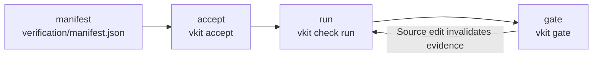

# Getting started

In this tutorial, you run a bundled Python CLI example to verify code behavior, trigger stale evidence, observe a failed check, and restore a passing gate.

## Prerequisites

Install [uv](https://docs.astral.sh/uv/getting-started/installation/), Git, and Python 3.11 or newer. Clone the VKit repository as shown in the [README](../README.md#get-started), then run every command below from the VKit checkout.

## How the verification loop works

VKit binds every check result to the source files, requirements, and tools it evaluated. Each repository follows four steps:



1. Declare checks and their declared inputs in `verification/manifest.json`.
2. Review and accept those definitions with `vkit accept`.
3. Execute checks with `vkit check run` to record fresh evidence.
4. Evaluate the gate with `vkit gate`. Any edit to a declared input marks prior evidence stale until you run the check again.

## Run the example

Run the quickstart script from the VKit checkout:

```sh
uv run python examples/quickstart.py
```

The script creates a fresh Git repository under `tmp/`, accepts the bundled `totals-behavior` check definition, runs its six scenarios, and evaluates the gate. You do not need to create a commit.

You should see `totals-behavior: PASS`, six passing scenarios, and a `READY` gate. The script prints the generated demo repository path at the start and end of its output. Replace `DEMO_PATH` in the commands below with that path.

Inside `DEMO_PATH`, `verification/manifest.json` registers a check that runs `src/totals.py` against six scenarios and compares the output to expected integer totals.

## Trigger stale evidence

Open `src/totals.py` inside `DEMO_PATH`. Find this line:

```python
running += amount
```

Change it to introduce an off-by-one defect per item:

```python
running += amount + 1
```

Check the repository status and gate without rerunning `totals-behavior`:

```sh
uv run vkit status --project DEMO_PATH
uv run vkit gate --project DEMO_PATH
```

You should see `totals-behavior` marked as `stale` in the status output. The gate prints `BLOCKED` and exits with code `3` because the previous passing run covers an older source snapshot.

## Run the check against the defect

Run `totals-behavior` against the edited file and evaluate the gate again:

```sh
uv run vkit check run --project DEMO_PATH --check totals-behavior
uv run vkit gate --project DEMO_PATH
```

You should see `totals-behavior: FAIL` with scenario observations showing the wrong totals. The gate prints `REJECTED`. Both commands exit with code `1`.

## Restore passing evidence

Change the line in `src/totals.py` back to `running += amount`. Then run the check and gate again:

```sh
uv run vkit check run --project DEMO_PATH --check totals-behavior
uv run vkit gate --project DEMO_PATH
```

You should see `totals-behavior: PASS` and a `READY` gate. Both commands exit with code `0`.

## Inspect runs in the console

Launch the local web console for the demo repository:

```sh
uv run vkit console --project DEMO_PATH
```

VKit starts a local server on `127.0.0.1` and opens the console in your browser. Use these views to inspect the demo:

- Open **Runs** to inspect the passing and failing attempts along with their scenario observations.
- Open **Checks** and select **Run** to submit a new attempt.
- Open **Feature map** to see which behaviors `totals-behavior` covers and which gaps remain.

The demo feature map lists explicit gaps for non-integer input and very large amounts. The gate checks registered requirements, while the feature map tracks application coverage.

## Exit codes

VKit commands return deterministic exit codes for scripts and CI jobs:

| Exit code | Meaning |
| --- | --- |
| `0` | Command succeeded, check returned `PASS`, or gate returned `READY`. |
| `1` | Check returned `FAIL` or gate returned `REJECTED`. |
| `2` | Request or manifest is invalid. |
| `3` | Check or gate is `BLOCKED`, or prerequisite check failed. |
| `4` | Internal error. |
| `5` | Required optional dependency or service is unavailable. |

## Configure your own repository

To add VKit to an existing repository, start from an [example](../README.md#documentation) that matches your language and runtime.

1. Create `verification/manifest.json` using the [manifest schema](../schemas/manifest.v3.json).
2. Verify prerequisites and manifest validity:

```sh
uv run vkit doctor --project /path/to/your-repository
```

3. Review the declared commands and inputs, then accept the definitions:

```sh
uv run vkit accept --project /path/to/your-repository
```

4. Run every missing or stale check and evaluate the gate:

```sh
uv run vkit check run --project /path/to/your-repository --needed
uv run vkit gate --project /path/to/your-repository
```

5. Optionally add `verification/features.json` to map application behaviors to checks. Follow the format in the [Python CLI feature map](../examples/python-cli/verification/features.json).

## Next steps

- Read the [console guide](console.md) for daily check execution, workspace switching, and tool settings.
- Read the [MCP tools guide](tool-discovery.md) to connect a coding agent over stdio.
- Read the [verification reference](verification.md) for Lean proofs, TLA+ model checking, Verus contracts, and change certification.
