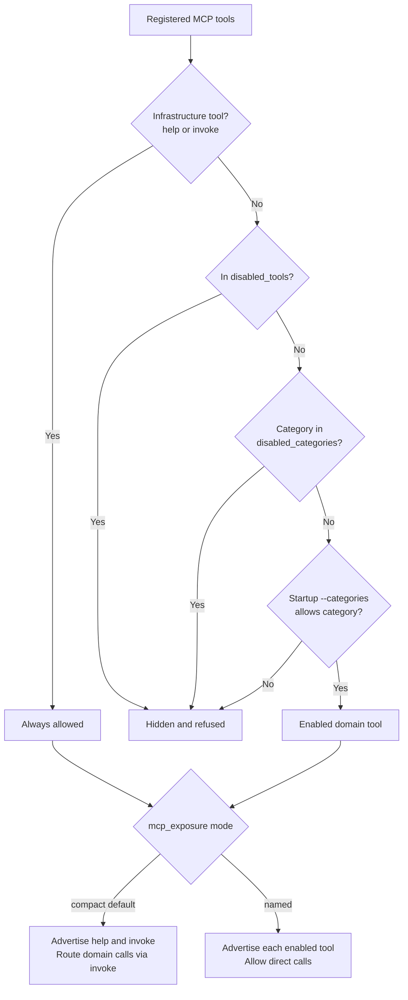

# MCP tools and discovery

This reference documents the VKit Model Context Protocol (MCP) server, tool catalog, exposure modes, and availability controls. The implementation lives in `src/vkit/mcp/__init__.py`, `src/vkit/core/categories.py`, `src/vkit/console/settings.py`, and `src/vkit/cli.py`. The CLI and MCP server share the same job store and project settings.

## Server startup and client configuration

Install the MCP extra from the VKit repository:

```sh
uv sync --extra mcp
```

Configure your MCP client to start a stdio server with absolute paths to the VKit checkout and the target repository:

```json
{
	"mcpServers": {
		"vkit": {
			"command": "uv",
			"args": [
				"run", "--directory", "/absolute/path/to/vkit",
				"vkit", "mcp", "serve",
				"--project", "/absolute/path/to/your-repository"
			]
		}
	}
}
```

Use your client's equivalent stdio configuration if it does not use the `mcpServers` schema. On Windows, use forward slashes such as `D:/projects/vkit` or escape backslashes in JSON.

The MCP client launches and owns the stdio process. Running `vkit mcp serve` in a standalone terminal does not attach it to an agent. Pass `--json` to `vkit mcp serve` to print the advertised tool definitions and exit.

## Exposure and filtering pipeline

Every tool request passes through saved settings and startup scope before exposure or execution.



## Tool catalog

Check definitions come from `verification/manifest.json`. No MCP tool accepts an arbitrary shell command. A human must review and accept definitions with `vkit accept` before they can run. Acceptance records trust in definitions. It is not a host security boundary for an agent that also has shell access.

| Tool | Category | Read-only | Purpose |
| --- | --- | --- | --- |
| `help` | None (infrastructure) | Yes | List enabled categories, search paged tool summaries, or fetch one exact input schema. |
| `invoke` | None (infrastructure) | No | Call one enabled domain tool by name and arguments in `compact` mode. |
| `status` | `repository` | Yes | Report check freshness (`fresh_pass`, `fresh_fail`, `fresh_blocked`, `stale`, `missing`, `not_approved`), gate state, and features. |
| `features` | `repository` | Yes | Read the feature map and coverage gaps, optionally filtered by free-text `query`. |
| `gate` | `repository` | Yes | Return the current gate verdict (`READY`, `READY_SCOPED`, `REJECTED`, or `BLOCKED`). |
| `check_run` | `repository` | No | Submit durable jobs for named `check_ids` or `needed=true`, waiting up to `wait_seconds` (max `60`, default `20`). |
| `verify` | `repository` | No | Submit a durable package verification job matching `schemas/verification-request.v2.json`. |
| `model_compare` | `repository` | Yes | Compare two explicit finite transition models matching `schemas/transition-comparison.v1.json`. |
| `change_certify` | `repository` | No | Submit shadow change analysis matching `schemas/change-certification.v1.json` against a `trusted_target_oid`. |
| `run_get` | `repository` | Yes | Read a run summary or selected sections (`summary`, `diagnostics`, `obligations`, `provenance`, `coverage`, `compilation`, `artifacts`, `log`, or `all`). |
| `run_wait` | `repository` | Yes | Wait up to `wait_seconds` (max `60`, default `20`) for a durable run and return its view. |
| `run_cancel` | `repository` | No | Request cancellation of a queued or running job and its descendants. |
| `evidence_export` | `repository` | No | Export an intact completed run to a destination bundle directory. |
| `evidence_replay` | `repository` | No | Submit a durable replay job for an evidence bundle using the currently accepted checker. |
| `propose` | `repository` | No | Stage proposed manifest checks, feature entries, files, or formal components for human review. |
| `feedback_add` | `repository` | No | Record a repository-local capability request in Markdown without affecting gates or proofs. |
| `feedback_list` | `repository` | Yes | List repository-local capability requests (`limit` `1` to `100`, formal requests first). |

## Exposure modes

| Mode | Advertised tools | Direct domain-tool calls | How to call domain tools |
| --- | --- | --- | --- |
| `compact` (default) | `help` and `invoke` | Refused (`unknown or unavailable tool`) | Call `invoke(name="<tool>", arguments={...})`. |
| `named` | `help` and each enabled domain tool | Allowed | Call the tool name directly. |

Both modes enforce the same argument schemas, handlers, and availability rules. Start in named mode with:

```sh
vkit mcp serve --exposure named
```

## Discovery and invocation in compact mode

Follow this sequence when connected in `compact` mode:

1. Call `help(all=true)` to list enabled tool summaries across pages.
2. Call `help(name="check_run")` to read the exact `inputSchema` for a tool.
3. Call `invoke` with the tool name and validated arguments.
4. Poll, wait for, or cancel the job with the returned `run_id`.

```text
invoke(name="check_run", arguments={"check_ids":["proof"],"wait_seconds":0})
invoke(name="verify", arguments={"schema_version":2,"claim":{"kind":"package","component":"allocation","policy_sha256":"<64 lowercase hex characters>","package_sha256":"<64 lowercase hex characters>"},"candidate":{"kind":"git_commit","oid":"<40 or 64 lowercase hex characters>"}})
```

`verify` requires a version 2 package claim (`schemas/verification-request.v2.json`) whose `component`, `policy_sha256`, and `package_sha256` match the current accepted manifest component. The package digest is stored in `verification/manifest.json`. The policy digest is the canonical SHA-256 of the complete component policy. On the CLI, `vkit verify COMPONENT --working-tree` and `vkit verify COMPONENT --candidate REVISION` resolve both digests from the manifest. `vkit verify --request FILE` reads the same version 2 JSON shape without granting checker or target authority.

## Discovery contract

`help` validates selectors and pagination according to `src/vkit/mcp/__init__.py`.

| Field or rule | Requirement |
| --- | --- |
| Top-level `contract_version` | `2`. |
| Per-tool `contract_version` | `1` (returned on exact `name` lookup). |
| No selector (`{}`) | Returns enabled `categories` with `id`, `label`, and `count`. |
| `name` lookup | Returns exact tool definition with `inputSchema`. Cannot combine with any other selector. |
| `all` and `category` | Mutually exclusive. Combining `all=true` and `category` is refused. |
| `offset` | Integer, minimum `0`, default `0`. Requires `category`, `query`, or `all=true`. |
| `limit` | Integer, `1` to `25`, default `10`. Requires `category`, `query`, or `all=true`. |
| Pagination | Follow `next_offset` until it is `null`. |
| Unknown or unavailable tool | Returns `{"error": "unknown or unavailable tool"}`. |
| Argument validation | Strict JSON Schema validation with `additionalProperties: false`. |
| `invoke` targets | Cannot target `help` or `invoke`. |

## Availability and scoping rules

| Control | Behavior |
| --- | --- |
| Categories | The sole category is `repository`, labelled `Repository checks and evidence` (`src/vkit/core/categories.py`). |
| Infrastructure tools | `help` and `invoke` cannot be listed in `disabled_tools`. `help` remains available in both modes. |
| Saved settings | Stored at `<git common directory>/vkit/config.json` (`src/vkit/console/settings.py`). Controls `disabled_tools`, `disabled_categories`, `mcp_exposure`, and `mcp_categories`. |
| Startup scope | `--categories` on `vkit mcp serve` overrides saved `mcp_categories` for that server process. Discovery cannot widen it. |
| Authorization | Discovery does not grant execution authority or modify accepted manifest definitions or checker pins. |
| Disabled tool calls | Refused immediately with `{"error": "unknown or unavailable tool"}`. |

## Console settings

Configure tool visibility in the web console under **Setup & tools > Project settings > Show tools**. Changes write to `<git common directory>/vkit/config.json`. Reconnect the MCP client after changing `mcp_exposure` or `mcp_categories`.

## CLI controls

| Command | Effect |
| --- | --- |
| `vkit tools --query WORDS` | List enabled tools matching all space-separated words. |
| `vkit tools --category repository` | Filter listed tools to the `repository` category. |
| `vkit tools --offset N --limit N` | Page through tool results (defaults: `offset=0`, `limit=10`). |
| `vkit tools --enable NAME` | Remove `NAME` from `disabled_tools`. |
| `vkit tools --disable NAME` | Add `NAME` to `disabled_tools`. |
| `vkit tools --enable-category repository` | Remove `repository` from `disabled_categories`. |
| `vkit tools --disable-category repository` | Add `repository` to `disabled_categories`. |
| `vkit mcp serve --exposure compact` | Serve in compact mode (`help` and `invoke`). |
| `vkit mcp serve --exposure named` | Serve in named mode (all enabled tools advertised individually). |
| `vkit mcp serve --categories repository` | Restrict startup scope to the `repository` category. |
| `vkit mcp serve --categories` | Pass no values to expose no domain tools. |
| `vkit mcp serve --categories all` | Override saved `mcp_categories` to allow every enabled category. |
| `vkit mcp serve --json` | Print the advertised tool definitions as JSON and exit. |
