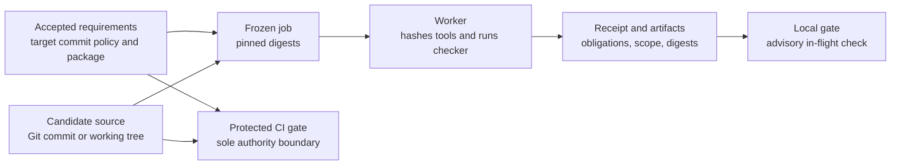

# Verification semantics

VKit separates accepted requirements, candidate source, verification execution, and retained evidence. A passing result establishes only the property and scope recorded by its method.

This reference covers verification components, formal verification layers, the resource-ledger contract, change certification, model comparison, and gates. For a first registered check, read [Getting started](getting-started.md). For change-certification Python APIs and execution profiles, read the [change-analysis integration reference](change-analysis.md).

## Components and trust chain

| Component | Responsibility |
| --- | --- |
| Mathematical package | Owns the model, expected contracts, proof sources, and verifier pins. |
| Component policy | Binds candidate API names, source entrypoint, and parameters to a package. |
| Job | Freezes candidate source and binds accepted policy, package, and checker identities. |
| Worker | Verifies actual tool bytes, executes the required procedure, and publishes evidence. |
| Receipt | Records obligations, scope, actual tool inventory, and retained artifact digests. |
| Local gate | Requires intact passing evidence for the intended source and policy authority. |
| Protected CI gate | Runs `vkit gate --candidate --target`. Requires target-owned accepted requirements over a fresh check of the combined candidate. |



The CLI and MCP server share one job service, store, and worker lifecycle. Formal requests use `schema_version: 2`. Each request sets `claim.kind` to `package` and names an accepted component in `claim.component`. Each request must include matching `claim.policy_sha256` and `claim.package_sha256` digests and select a candidate source. Requests cannot supply replacement formulas, checker commands, or a smaller obligation set. VKit rejects legacy `implements` goals and finite claims. Library finite preflight binds a request to a trusted target, and it does not verify candidate behavior.

## Formal verification layers

VKit checks its own trust boundaries and packaged contracts across three separate layers:

- TLA+ protocol and decision models in `formal/models/` checked by TLC.
- Verus source proofs for `vkit.resource-ledger` in `src/vkit/formal/packages/resource_ledger/`.
- Exhaustive real-code Python checkers in `formal/checks/` that run production functions over complete finite abstract domains.

```mermaid
flowchart TB
  subgraph Models[TLA+ models in formal/models/]
    M1[lifecycle/Attempts.tla]
    M2[certification/Authority.tla]
    M3[certification/ShadowAuthority.tla]
    M4[certification/Differences.tla and DifferenceDecisionBridge.tla]
    M5[DelegatedClaimAuthority.tla]
    M6[FiniteTransitionComparison.tla]
  end

  subgraph Verus[Verus proofs in src/vkit/formal/packages/]
    V1[resource_ledger/ledger.rs]
    V2[resource_ledger/expected.rs.in]
    V3[resource_ledger/runtime.rs.in]
  end

  subgraph Checkers[Exhaustive Python checkers in formal/checks/]
    C1[check_finite_decisions.py]
    C2[check_gate_verdicts.py]
    C3[check_kani_classifier.py]
    C4[check_delegation_algebra.py]
    C5[check_verifier_interpreters.py]
  end

  M1 --> R1[Job lifecycle and attempt publication]
  M2 --> R2[Policy, receipt, and reuse authority]
  M3 --> R2
  M4 --> R3[Change-difference assessment]
  M5 --> R4[Delegated claim acceptance]
  M6 --> R5[Finite transition comparison]
  V1 --> R6[Ledger contract and representation refinement]
  V2 --> R6
  V3 --> R6
  C1 --> R3
  C2 --> R2
  C3 --> R3
  C4 --> R4
  C5 --> R2
```



### TLA+ models

Seven TLA+ modules model VKit's lifecycle, authority, change-certification, delegated-claim, and finite-comparison rules. Each suite verifies clean configurations and requires deliberate fault configurations to produce counterexamples.

| Model | Configurations | Qualification script | Scope |
| --- | --- | --- | --- |
| `formal/models/lifecycle/Attempts.tla` | `formal/models/lifecycle/Attempts.cfg` | `formal/checks/check_lifecycle.py` | Up to three attempts, shared job identity, cancellation, worker loss, and publication pointer. |
| `formal/models/certification/Authority.tla` | `Authority.cfg` plus 7 fault configs | `formal/checks/check_authority.py --suite authority` | Request claims, protected target selection, capture binding, receipt binding, and reuse after drift. |
| `formal/models/certification/ShadowAuthority.tla` | `ShadowAuthority.cfg` plus 4 mutant configs | `formal/checks/check_authority.py --suite shadow` | Separation between shadow change-certification receipts and required gate slots. |
| `formal/models/certification/Differences.tla` | 6 clean configs, 2 reachability configs, 8 mutant configs | `formal/checks/check_authority.py --suite differences` | Paired observation assessment, guard intersection, violation visibility, repairs, and empty domains. |
| `formal/models/certification/DifferenceDecisionBridge.tla` | Uses the 6 clean `Differences` configs | `formal/checks/check_difference_decisions.py` | Compares every terminal TLC decision against the Python assessor in `src/vkit/change/certification.py`. |
| `formal/models/DelegatedClaimAuthority.tla` | `good.cfg` plus 10 fault configs in `formal/models/delegated-claim/` | `formal/checks/check_delegated_claim_authority.py` | Trusted target basis, entailment, strict strengthening, near-miss rejection, and restricted Kani scope. |
| `formal/models/FiniteTransitionComparison.tla` | `formal/models/finite-transition/complete.cfg` | `formal/checks/check_transition_comparison.py` | Complete comparison of two-state finite transition models against VKit's comparator. |

For details on the certification models and how to run them, read [the certification models reference](../formal/models/certification/README.md).

### Verus ledger proofs

The `vkit.resource-ledger` package stores its Verus specification, expected client template, empirical runtime driver, and tool pins in `src/vkit/formal/packages/resource_ledger/`. Qualification scripts verify the package and container lifecycle end to end:

- `formal/checks/check_verus_ledger.py` checks the package, mutations, adequacy predicates, and optional `--compare-package` diffs.
- `formal/checks/check_ledger_container.py` exercises containerized Verus verification and asset pinning.
- `formal/checks/check_ledger_refinement.py` checks alternate data representations against `LedgerView`.
- `formal/checks/qualify_ledger_reuse.py` checks reuse behavior and receipt preservation across changes.
- `formal/checks/verify_formal.py` runs real Lean and TLC checks through VKit's public CLI in disposable Git repositories.

### Exhaustive real-code Python checkers

Five standalone checkers in `formal/checks/` import production functions from `src/vkit/` and enumerate complete finite abstract input spaces. Each checker compares real return values against an independent specification oracle, enforces explicit safety invariants, and proves that deliberate negative-control mutants fail the check.

| Checker | Production target | Domain checked | Negative controls | Pytest entrypoint |
| --- | --- | --- | --- | --- |
| `formal/checks/check_finite_decisions.py` | `src/vkit/change/certification.py` | 354,346 decision tuples across 274 valid policies and 46 rejected conflicting guard policies | 2 mutants | `tests/change/test_finite_decisions.py` |
| `formal/checks/check_gate_verdicts.py` | `src/vkit/core/state.py` (`gate`) | 10,820 decision tuples (10,692 full-matrix and 128 pairwise) | 5 mutants | `tests/formal/test_gate_verdicts_formal.py` |
| `formal/checks/check_kani_classifier.py` | `src/vkit/rust/kani_result.py` (`classify_kani_result`) | 46,875 status tuples (46,915 total cases including counterexample and exit-code checks) | 3 mutants | `tests/formal/test_kani_classifier_formal.py` |
| `formal/checks/check_delegation_algebra.py` | `src/vkit/change/certification.py` (`check_delegation`, `compare_contracts`, `intent_entails_claim`) | 26,417 delegation tuples (156 accepted, 26,261 rejected) plus 257 contract comparisons and 257 entailment checks | 5 mutants | `tests/formal/test_delegation_algebra_formal.py` |
| `formal/checks/check_verifier_interpreters.py` | `src/vkit/verifiers/lean_adapter.py` and `src/vkit/verifiers/tlc_adapter.py` (`interpret`, `logical_trust_from_report`) | 868 Lean tuples (864 reviewed, 4 comparator, 3 logical-trust checks) and 384 TLC tuples | 4 mutants | `tests/formal/test_verifier_interpreters_formal.py` |

Run all five exhaustive checkers through pytest:

```sh
uv run pytest tests/change/test_finite_decisions.py tests/formal/test_gate_verdicts_formal.py tests/formal/test_kani_classifier_formal.py tests/formal/test_delegation_algebra_formal.py tests/formal/test_verifier_interpreters_formal.py
```

These checkers establish exact conformance only over their declared finite abstract domains. They do not prove properties of arbitrary runtime inputs outside those domains.

## Resource-ledger contract

`vkit.resource-ledger` provides one generic positive-sized `Ledger<N>` model. Its invariant requires positive active amounts, unique reservation IDs, bounded record count, cached usage equal to the map's reservation total, and usage at most capacity. IDs, owners, capacities, and amounts have type `u32`. Batch capacity is three. Command arrays have compile-time length `M`.

| Binding | Required behavior |
| --- | --- |
| `new` | Clear supplied preallocated slots and construct a valid empty ledger. |
| `reserve` | Reject zero amount, duplicate ID, full storage, or exceeded capacity in that order. Success inserts the exact record. Rejection preserves state. |
| `release` | Check existence before ownership. Success removes the ID and returns its amount. Rejection preserves state. |
| `reserve_batch` | Check count first, process requests in order, and return the first failing index. Commit all requests together or preserve the original state. |
| `apply_command` | Match the model's operation and tagged response. |
| `run_commands` | Relate every state and response in an `M+1` trace to the command model. Empty traces preserve the initial state. |

The verifier freshly checks and exports the owned library, then the candidate, then an unchanged expected client that imports both. The client calls all six bound symbols under the accepted preconditions and requires the owned postconditions. Stronger candidate preconditions or weaker postconditions fail that check. Fixed strict arguments reject unchecked bodies and partial verification.

The package also checks `transfer` against an atomic two-ledger model. Success conserves combined usage. Either failure preserves both ledgers and identifies the failing operation. `SharedLedger` uses the pinned vstd write lock to preserve valid state and establish each completed reserve or release transition. These package contracts are separate from candidate API coverage. They do not establish global history linearizability, lock liveness, or abort recovery.

The same procedure compiles the checked candidate and library into a retained executable and runs fixed observations through the bound APIs. The `compilation` query section records source, driver, and artifact digests, compiler arguments, and empirical results. Compilation trusts Verus erasure, Rust, and the linker. It supplies no independent translation-validation theorem.

The result records contract `ledger.source.v1`, method `verus_source`, assurance `trusted_engine`, and coverage `required_api`. Extra exports and surrounding application code remain unclaimed. The trust boundary includes Verus, Rust, vstd, and SMT solving. This check is source verification, not independently checked kernel-certificate evidence or a source-to-binary theorem. Resource aborts remain possible, and source loop measures do not establish an operational step bound.

## Component configuration

A version-3 manifest contains `checks` and an optional `formal.components` list. Each component follows this structure:

```json
{
  "id": "allocation",
  "package": {
    "id": "vkit.resource-ledger",
    "version": "0.1.0",
    "sha256": "<installed-package-sha256>"
  },
  "contract": "ledger.source.v1",
  "source": {"entry": "src/allocation.rs"},
  "profile": "verus-linux-x86_64-v1",
  "parameters": {"max_records": 3},
  "bindings": {
    "new": "api::new",
    "reserve": "api::reserve",
    "release": "api::release",
    "reserve_batch": "api::reserve_batch",
    "apply_command": "api::apply_command",
    "run_commands": "api::run_commands"
  },
  "required": true
}
```

Bindings are relative Rust identifier paths in the candidate library. The default state type is the owned `Ledger<N>`. An optional `"representation": "columns::Columns"` selects a candidate type with the same ordered `LedgerView`. The expected client checks the owned invariant and all six contracts against that view. The [split-column example](../examples/ledger-refinement/columns.rs) uses verified conversions with O(N) cost. This profile does not translate arbitrary Rust code. For full schema rules and reuse fixtures, read the [version-3 manifest schema](../schemas/manifest.v3.json) and [API reuse fixtures](../examples/ledger-reuse/README.md).

Read the installed package digest with this command:

```sh
uv run python -c "from vkit.formal.ledger import load_package; print(load_package().identity.sha256)"
```

Acceptance binds policy, package, and checker digests. Changing any of those three digests requires renewed acceptance. Submission retains the accepted checker digest. The worker hashes actual tool bytes before verification and records their inventory in the receipt. Host paths do not affect a formal job's semantic identity.

The `verus-linux-x86_64-v1` profile requires Linux x86_64 and Docker. Host configuration supplies `VKIT_VERUS_IMAGE`, `VKIT_VERUS_ARCHIVE`, `VKIT_VERUS_ROOT`, `VKIT_RUSTUP_HOME`, and `VKIT_CARGO_HOME`. `VKIT_VERUS_IMAGE` must be an installed full `sha256:` image ID. The [package pins](../src/vkit/formal/packages/resource_ledger/upstream.json) specify official Verus `0.2026.10.18.7d82994` and Rust `1.99.1`. Missing or changed assets block checking. Dependency acquisition and candidate build scripts do not run inside verification.

## Source capture and execution

| Source | Identity and capture |
| --- | --- |
| Formal working tree | Raw tracked and untracked nonignored bytes. Produces provisional evidence. |
| Formal Git commit | Immutable raw commit, tree, and blob identities, file modes, and bytes. Dirty checkout edits cannot alter the subject. |
| Registered local check | Selected declared inputs, with CRLF normalized to LF for content identity. |

Formal capture rejects secret-looking paths, links, submodules, and unsupported files. Registered local selectors exclude secret-looking paths. Neither policy inspects file contents for secrets. Declare source, specification, configuration, and trusted dependencies explicitly because VKit cannot infer arbitrary dependency closures.

Formal attempts run in restricted containers with read-only source and tools, no network access, non-root execution, and private output storage. Cancellation and recovery target only the attempt's owned container. Retained evidence rejects links, special files, and unlisted artifacts, and it enforces a post-execution limit of 10,000 entries and 512 MiB. This limit is not an aggregate execution-time disk quota. Local registered adapters retain service-user filesystem permissions.

## Results, evidence, and replay

| Dimension | Meaning |
| --- | --- |
| Execution state | `queued`, `running`, `done`, or `interrupted`. |
| Outcome | `PASS`, `FAIL`, or `BLOCKED`, according to the method. |
| Claim outcome | `established`, `refuted`, or `unknown`, within recorded assumptions and scope. |
| Assurance | `empirical`, `finite_model`, `kernel_proof`, or `trusted_engine`. |
| Freshness | Whether retained evidence still matches the intended source, policy, and checker. |

Engine outcomes map to claim outcomes by strict rules:

- A rejected Lean proof leaves its theorem `unknown`.
- A TLC safety counterexample refutes an invariant only after replay against the frozen model and configuration reproduces both the named violation and the ordered state sequence.
- Unsupported or unvalidated witnesses leave the claim `unknown`.
- A failed Verus obligation produces `BLOCKED` with an `unknown` claim.
- Registered test checks retain `empirical` assurance.

Each submission creates a unique run for a content-derived job by default. Opt-in `verify --reuse` (MCP `reuse: true`) requires intact passing local evidence with identical full captured source, accepted policy, package, checker, and target authority. Reuse rechecks current tool identity and preserves the original receipt, and it does not infer a smaller dependency closure. Retry creates a new run for the same frozen job. Worker loss records `interrupted` execution, never `PASS`. A bounded wait can time out while its worker continues running.

The [lifecycle model](../formal/models/lifecycle/Attempts.tla) checks a finite abstraction with at most three attempts, shared job identity, and a publication pointer. The [qualification script](../formal/checks/check_lifecycle.py) separately exercises concurrent attempts, cancellation and completion contention, worker loss, recovery, and retry through the production job API. Model checking and runtime observations provide separate evidence. Together they do not establish trace conformance, every runtime interleaving, or implementation refinement.

CLI and MCP run responses default to a summary with identities, status, obligation counts, and the next action. CLI `--section` flags and MCP `sections` select `diagnostics`, `obligations`, `provenance`, `coverage`, `compilation`, `artifacts`, or `log`. Coverage maps claims to bindings and behaviors, lists separate package claims, and identifies unclaimed application code. You can request one section, several sections, or `all`. Section selection reads retained results without changing verification scope or starting another run. Logs and artifact lists are bounded and support paging.

```sh
vkit run show --run <run-id> --section diagnostics --section provenance --json
```

Obligation counts separate observed results from unobserved obligations. When a partial result lacks the required denominator, `total` and `unknown` are `null`.

Provenance includes `logical_trust` when available. It distinguishes engine-reported axioms, accepted policy assumptions, unchecked dependencies, and unreported information. Lean reports axioms per theorem. TLC records finite-model scope. Verus records its trusted engine dependencies without claiming a complete axiom audit. VKit marks an external checker as checked only after accepting its bound receipt. Execution limits and performance budgets stay separate from logical trust.

Diagnostics include supported locations in captured source. Lean columns are normalized to one-based positions. TLC retains native JSON witnesses as artifacts and records replay and bounded minimization results. VKit retains a shorter candidate only after another successful validation, and exhausting a budget does not establish minimality. Native TLC replay uses the exact build and digest pinned by the model configuration and CI download.

Receipts bind the job, source, outcome, obligations, checker, and artifact digests. Export validates the bundle. Replay independently captures the candidate, requires matching accepted identities, and runs checking again. Imported success flags cannot satisfy replay. Digests provide integrity relative to trusted state. They do not authenticate an external writer or prove verifier soundness.

Formal `evidence export --include-assets` preserves the exact Docker image, official Verus archive, and expanded tool trees in a digest-bound capsule. `evidence replay --restore-assets` restores those assets on Linux x86_64 before running a fresh check under the currently accepted policy. MCP exposes the corresponding `include_assets` and `restore_assets` booleans. Capsules enforce separate 16 GiB archive and total limits and a 100,000-entry limit per tool tree. They require the installed VKit runtime and the independently available candidate source. A matching image tag is insufficient.

Package qualification classifies deliberate mutations as detected rejections, survivors, or inconclusive runs. Package comparisons report changed assets, obligations, and trust identities, and they leave package-wide semantic equivalence unknown. `formal/checks/check_verus_ledger.py` accepts `--compare-package` with an earlier report or package snapshot.

Ledger adequacy qualification checks that the reserve precondition is satisfiable and that remaining-capacity and total-usage admission predicates agree. A strict-bound control checks admission at exact capacity, and a false equivalence must be rejected. These checks cover the recorded predicates and witnesses, and they do not establish specification completeness. For qualification models and test data, read [Verification models and test data](../CONTRIBUTING.md#verification-models-and-test-data).

## Delegated claim acceptance

`vkit change certify` and MCP `change_certify` can accept an agent-proposed finite claim when the request includes `delegation`. The host separately selects the trusted target commit. That target must contain an accepted baseline and assumptions under `verification/change-claims/`, and the candidate must preserve those records. The basis uses [delegation-basis.v1.json](../schemas/delegation-basis.v1.json), and [accepted-claim-bases.v1.json](../schemas/accepted-claim-bases.v1.json) defines the registry. The request names the basis digest and a legal input with a baseline-permitted output that both the accepted intent and proposed claim forbid.

VKit checks that the accepted intent together with the assumptions entails the claim, and that the claim strictly strengthens the baseline without dropping legal inputs. Delegated requests use only the admitted captured Rust Kani model on Linux x86_64. They require a complete independent claim-satisfaction check and rejection of the generated near-miss mutation. Native samples cannot grant acceptance. Unsupported methods, incomplete results, and cancellation leave acceptance unknown.

A successful job retains `change-output/claim-acceptance.v1.json` with `accepted_by` set to `agent_strengthening`. That record binds the basis, claim, commits, captures, checker, and both proof results. CLI and MCP summaries expose acceptance only after validating the sealed evidence. The shadow change result and the delegated claim result stay separate, so a relational check can pass while the proposed claim is refuted.

Acceptance applies only to `restricted_captured_rust_kani_model`. It does not establish native compiler correspondence, approve code, satisfy a registered check, or change the current standing intent. A later trusted target must explicitly adopt the claim as its new baseline. Local host state and the selected verifier remain trusted, and receipt digests do not authenticate an external writer.

## Finite transition model comparison

`vkit model compare --request examples/model-comparison/request.json --json` compares two explicit finite models. MCP `model_compare` takes the same JSON object in its `request` argument. The [example request](../examples/model-comparison/request.json) changes a toggle so its second click leaves it open. The report identifies the changed transition and gives the two-step path that reaches it.

Each model declares finite state, action, input, and observation alphabets. `initial_states` selects the starting states. `assumptions` enumerates permitted environment contexts. Each rule lists its source, action, permitted input values, and possible targets. Those input sets act as guards. `state_observations` assigns one observation to every state. There is no embedded expression language or executable code.

VKit follows all enabled transitions from all initial states, including cycles and nondeterministic targets. It compares reachable states, reachable assumption contexts, enabled input contexts, transitions, and observations. A reachable-state change can therefore change several report categories. Changes confined to unreachable sources, or guards masked by assumptions, do not change reachable behavior. Tokens identify exact semantic states, so renamed states and different alphabets are incomparable. Reordering arrays does not change the result.

An `equivalent` or `different` result covers the complete declared finite space under this comparison meaning. Each difference category includes its count and a shortest deterministic witness. An assumption or guard probe names a context to inspect rather than an executed transition. The optional `max_contexts` budget defaults to 32,768 across both models. Expanded rule edges have a separate 65,536 limit. Exceeding either budget returns `unknown` without partial equivalence. CLI exit codes are 0 for `equivalent`, 1 for `different`, and 3 for `incomparable` or `unknown`.

This read-only operation compares caller-provided models. It does not establish trace equivalence across renamed states, liveness, fairness, source conformance, or code approval, and it creates no accepted policy record.

## Capability feedback

CLI `feedback add` and MCP `feedback_add` record a task, a missing capability, and its expected verification benefit. `kind` defaults to `formal`, and `reliable` covers other rigorous checks. An optional run ID links the request to retained evidence.

Each submission creates a Markdown file under the repository's shared Git directory at `vkit/feedback/`. Duplicate submissions preserve the existing file. CLI `feedback list` and MCP `feedback_list` provide bounded previews, with formal verification requests first. Feedback does not affect verification results or gates.

## Gates and CI

A local gate is `READY` only when all registered checks and required formal components have intact current passing evidence. A failed empirical check can produce `REJECTED`. Missing, stale, or inconclusive evidence produces `BLOCKED`. Display filters cannot reduce requirements.

The [protected CI gate](../examples/protected-ci/README.md) loads requirements from the exact target commit and freshly checks the combined candidate. It uses a private store outside candidate execution and imports neither local approvals nor branch receipts. The protected CI gate is the only real authority boundary in VKit. The local gate and evidence ledger form the advisory in-flight loop. You must protect host workflow, installation, policy governance, and merge enforcement separately.

| Exit code | Meaning |
| --- | --- |
| `0` | `PASS` or `READY`. |
| `1` | `FAIL` or `REJECTED`. |
| `2` | Invalid request. |
| `3` | `BLOCKED`. |
| `4` | Internal error. |
| `5` | Unavailable interface. |

## What local verification does not protect against

The local gate and evidence ledger run on a host that the operator already trusts. They do not protect against these local actions:

- **Shell-level tampering.** Anyone with shell access can edit or delete evidence, approvals, or check definitions in VKit storage. Receipt digests provide integrity relative to trusted local state, and they do not authenticate an external writer. Read-time revalidation rejects receipts that disagree with their run record, not a consistently forged record and flags.
- **Self-approval.** `vkit accept --yes` fails unless the operator environment sets `VKIT_ALLOW_YES`. An operator-authorized `--yes` in the same shell stays in CI-gate scope.
- **Deletion of checks.** Removing a check definition causes the local gate to return `REJECTED` with `obligation_removed`. Hiding that deletion requires shell-level store edits, which stay in CI-gate scope.

The [protected CI gate](../examples/protected-ci/README.md) covers all three cases. It loads requirements from the exact target commit and checks the combined candidate in a store outside candidate execution, so candidate-side tampering, self-approval, and check deletion cannot satisfy it. The local ledger remains advisory. The Stop and SubagentStop hook is also advisory with one forced retry: it blocks one stop, allows the next stop, enforces `not_approved` and `obligation_removed`, and fails closed on errors.

## Foundations

The design draws on [Anthropic's formal-verification research](https://www.anthropic.com/research/formal-verification) and [Verus's checking and trust model](https://verus-lang.github.io/verus/guide/tcb.html). VKit reuses the pinned [vstd map laws](https://github.com/verus-lang/verus/blob/7d829946231d6413a398f6e4160cdfe951261dad/source/vstd/map_lib.rs) and [vstd sequence laws](https://github.com/verus-lang/verus/blob/7d829946231d6413a398f6e4160cdfe951261dad/source/vstd/seq_lib.rs) for ledger accounting. Those sources do not expand the scope of VKit's recorded claim.
