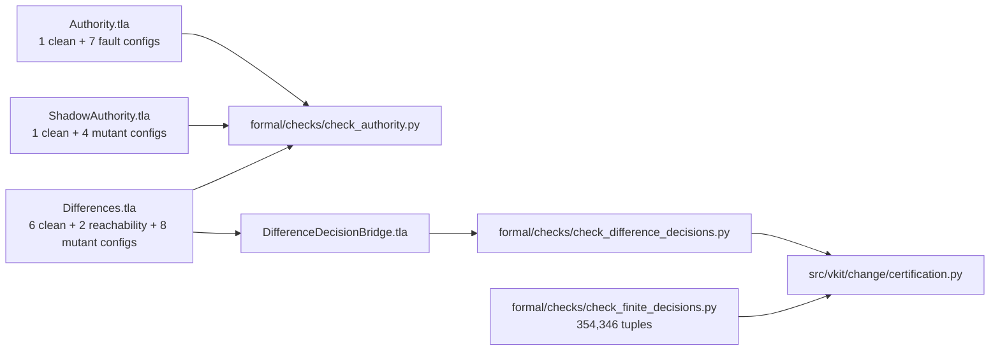

# Certification models

This directory contains TLA+ models and TLC configurations for VKit's verification authority, shadow-receipt separation, and finite change-difference assessment. These models are bounded developer checks of VKit's decision logic.



## Model inventory

| Module | Configurations | Runner | Purpose |
| --- | --- | --- | --- |
| `Authority.tla` | `Authority.cfg` plus 7 fault configs | `formal/checks/check_authority.py --suite authority` | Submission, receipt validation, target authority, and reuse after drift. |
| `ShadowAuthority.tla` | `ShadowAuthority.cfg` plus 4 mutant configs | `formal/checks/check_authority.py --suite shadow` | Isolation between shadow change-certification receipts and required gate slots. |
| `Differences.tla` | 6 clean configs, 2 reachability configs, 8 mutant configs | `formal/checks/check_authority.py --suite differences` | Paired observation assessment, guard intersection, violation visibility, repairs, and empty domains. |
| `DifferenceDecisionBridge.tla` | Reuses the 6 clean `Differences` configs | `formal/checks/check_difference_decisions.py` | Emits terminal TLC decisions and compares each one with the Python assessor. |

Other repository models live outside this directory:

- `formal/models/lifecycle/Attempts.tla` models job attempt lifecycle and publication.
- `formal/models/DelegatedClaimAuthority.tla` models delegated claim acceptance.
- `formal/models/FiniteTransitionComparison.tla` models finite transition comparison.

## Authority

`Authority.tla` models submission, receipt validation, and evidence reuse. A request binds its component claim, policy, package, checker, and captured source. Protected CI derives its component and target from host-selected policy, so candidate policy cannot select that authority.

Jobs and receipts retain the submitted snapshot when policy, tools, or source change. Reuse checks current identities against that snapshot. A passing historical receipt therefore does not establish that the current checkout can pass the gate.

`Authority.cfg` configures one job, one component, two revisions each of policy, package, checker, and source, one trusted target, and one candidate target. Qualification verifies the invariants on `Authority.cfg` and requires all seven fault configurations to produce counterexamples:

- `Authority.bad-claim.cfg` checks `ClaimPinned`.
- `Authority.candidate-target.cfg` checks `TargetAuthorityPinned`.
- `Authority.wrong-capture.cfg` checks `CandidateCapturePinned`.
- `Authority.swapped-receipt.cfg` checks `ReceiptBound`.
- `Authority.stale-reuse.cfg` checks `ReuseDecisionBound`.
- `Authority.false-reject.cfg` checks `ReuseRejectedBound`.
- `Authority.preflight-pass.cfg` checks `PreflightNotProof`.

Runtime tests in `tests/core/` and `tests/formal/` separately exercise claim rejection, protected target selection, source capture, receipt validation, and reuse after drift.

## Shadow authority

`ShadowAuthority.tla` models three receipt slots that share one identifier: `registered_check`, `formal_goal`, and `change_certification`. Only `registered_check` and `formal_goal` are required gate slots.

Qualification verifies `ShadowAuthority.cfg` and requires four fault configurations to produce counterexamples:

- `ShadowAuthority.verus.cfg` checks `ShadowReceiptPolicy`.
- `ShadowAuthority.established.cfg` checks `ShadowReceiptPolicy`.
- `ShadowAuthority.gate-requires-shadow.cfg` checks `GateMatchesRequiredSubjects`.
- `ShadowAuthority.gate-accepts-shadow.cfg` checks `GateMatchesRequiredSubjects`.

## Finite difference assessment

`Differences.tla` models the collection and assessment of paired observations. The bounded configuration explores ordered sequences of zero, one, or two records from a finite pool over two inputs. Six clean configurations cover the bounded default (`Differences.cfg`), invalid shrink handling (`Differences.invalid-shrink.cfg`), violation visibility with missing evidence (`Differences.violation-missing.cfg`), overlapping guards (`Differences.guard-overlap.cfg`), standing-intent repairs (`Differences.repair.cfg`), and an empty admissible domain (`Differences.empty.cfg`).

The model verifies five core rules:

- Selected inputs require evidence.
- Overlapping guards intersect rather than union.
- Violations remain visible when other evidence is missing or unknown.
- Repairs that satisfy standing intent are accepted.
- An empty admissible domain remains unknown.

Two reachability controls (`Differences.reach-conformance.cfg` and `Differences.reach-empty-done.cfg`) establish that completion and conformance states are reachable. Eight mutant configurations (`Differences.mutant-*.cfg`) must produce counterexamples.

Two real-code checks complement the TLA+ model:

- `tests/change/test_differences.py` exercises the public parsers and Python assessor with concrete observations, including duplicate records, intersecting guards, repairs, and incomplete evidence.
- `formal/checks/check_finite_decisions.py` (invoked by `tests/change/test_finite_decisions.py`) exhaustively checks 354,346 finite decision tuples directly against `src/vkit/change/certification.py`.

## TLC and Python decision comparison

`DifferenceDecisionBridge.tla` extends `Differences.tla` and prints terminal decisions from the six clean configurations without changing their transition relation. `formal/checks/check_difference_decisions.py` runs TLC on all six configurations and compares every emitted decision with the public Python assessor in `src/vkit/change/certification.py`. Record order and multiplicity are preserved. Negative controls alter a modeled violation or terminal status to verify that the comparator detects disagreement.

## Run qualification

Running the TLC suites requires Java (resolved from `JAVA_HOME` or `PATH`), the repository's Python environment, and the repository-pinned `tla2tools.jar`.

From the repository root in a POSIX shell:

```sh
export VKIT_TLA2TOOLS_JAR=/path/to/tla2tools.jar
export PYTHONPATH=src
uv run python formal/checks/check_authority.py --suite authority
uv run python formal/checks/check_authority.py --suite shadow
uv run python formal/checks/check_authority.py --suite differences
uv run python formal/checks/check_difference_decisions.py --output tmp/difference-decisions
```

From the repository root in PowerShell:

```powershell
$env:VKIT_TLA2TOOLS_JAR = 'PATH_TO_JAR_MATCHING_REPOSITORY_PIN'
$env:PYTHONPATH = (Resolve-Path '.\src').Path
.\.venv\Scripts\python.exe formal\checks\check_authority.py --suite authority
.\.venv\Scripts\python.exe formal\checks\check_authority.py --suite shadow
.\.venv\Scripts\python.exe formal\checks\check_authority.py --suite differences
.\.venv\Scripts\python.exe formal\checks\check_difference_decisions.py --output tmp\difference-decisions
```

Run the exhaustive Python decision checker without Java or TLC:

```sh
uv run pytest tests/change/test_finite_decisions.py
```

The authority, shadow, and difference suites create isolated VKit projects and run TLC through VKit's registered-check interface. Reports, model copies, checker output, and comparison evidence are retained under `tmp/`.

## Scope

Results cover only the configured finite models and the runtime cases compared with them. Hashes and Git identities are opaque atoms. The authority and shadow models do not model host authorization, human acceptance, scheduler concurrency, verifier correctness, or cryptographic collision resistance. The difference models do not cover arbitrary program inputs or longer observation sequences. Agreement with the Python assessor is bounded evidence, not a general proof that the implementation refines the model. Fault and mutant configurations are qualification controls, not reports of production defects.
